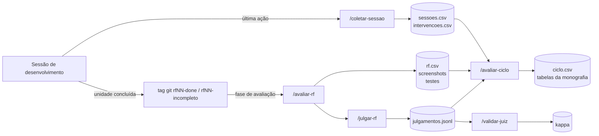

# Instrumento de Medição dos Ciclos Comparativos — Métricas e Skills

**Projeto:** TCC Wagner Duarte — GitHub Spec Kit × BMAD-METHOD (veículo: app Cerne)
**Versão:** **v1.0** (22/09/2026), derivada da revisão v2 de 22/09/2026, com as decisões dos `GATE-C01`–`C03` do `plano-ciclos.md` (`C-001`, `C-002`)
**Status:** publicada; o hash SHA-256 é registrado no congelamento do protocolo (`GATE-C23`, tag `protocolo-v1.0`). Depois disso, toda mudança é desvio em `docs/desvios.md`
**Documento irmão:** `protocolo.md` — decisões P1–P14, regras por metodologia e regras operacionais de conduta do pesquisador (fonte única; §9)
**Histórico:** v2 (22/09/2026) — fundamentação bibliográfica e ajustes derivados da literatura incorporados em cada métrica (§5), mapeamento das métricas nas dimensões de Macedo (2026) (§5.6), plano de análise (§14) e referências (§15)
**Documentos de origem:** `Requisitos_e_Fluxo_de_Telas_TCC.md` (§3, §8, §11), `doc-prototipo.md` (§4), decisões D1–D18, `Bibliografia_Complementar_TCC_Wagner.md`, `plano-ciclos.md` (`GATE-C01`–`C03`)

**Mudanças da v1.0 em relação à v2** (registro das decisões em `docs/revisoes/gate-c01-roteiro-revisao.md` e nos `GATE-C02`/`C03` do plano): skill de coleta como skill de usuário, fora do repositório do app; ID `PLAN`; JSONL como fonte primária, com subagentes e OpenTelemetry como conferência; prefixo `PROCESSO:` como série M5b; suíte hold-out só na tag `final`; M8b condicional; ferramentas de M7 e M12 (scripts próprios); avaliador de outra família (OpenAI); pareamento por RF só nas fases `IMPL` + `VALID`; superfície VS Code com extensão (P2) e uma sessão por comando do Spec Kit (P4), com os ajustes correspondentes na M14, na §5.6 e na §12; censura pela timebox; método de Pratt; convenção de tags ampliada; esquema de dados coluna a coluna (§8). Os opcionais da v2 (estimativa prévia, estabilidade de decisões) não foram adotados; a leitura dimensional final (§5.6) foi adotada.

---

## 1. Propósito

Este documento define **o que é medido, como e por qual ferramenta** nos dois ciclos comparativos. Ele é parte do instrumento experimental: vale igualmente para o Ciclo A (Spec Kit) e o Ciclo B (BMAD-METHOD), e qualquer alteração depois do congelamento precisa ser registrada como desvio de protocolo na monografia.

Cobre as 15 métricas da §8 do documento de requisitos (numeradas 1–15 abaixo) e o log de classificação de bugs da D16.

**Fundamentação bibliográfica (v2).** Cada métrica passa a ter dois blocos adicionais:
- **Fundamentação bibliográfica (blindagem):** quais referências sustentam o construto, o mecanismo de medição ou a interpretação da métrica, com a seção citada, para que cada escolha do instrumento possa ser defendida perante a banca.
- **Ajustes derivados da literatura:** mudanças na operacionalização que aproximam a métrica das referências.

Os ajustes usam três marcações:
- *[INCORPORADO]*: já refletido nas colunas de dados (§8), nas regras (§9) e no cronograma (§11);
- *[OPCIONAL]*: depende de decisão registrada em §13;
- *[ADOTADO CONDICIONALMENTE]* / *[NÃO ADOTADO]*: resultado da decisão na v1.0 (§13);
- *Nenhum*: a literatura levantada não justifica mudança, e nada foi forçado.

Quando uma métrica não tem respaldo nas referências levantadas, isso é dito explicitamente. As referências completas estão na §15, com a indicação de quais foram lidas na íntegra e quais precisam ser conferidas na fonte primária antes de entrar na monografia.

---

## 2. Princípios do instrumento

**P1 — Invisibilidade para o agente medido.** Nada do instrumento pode entrar no contexto do agente durante o desenvolvimento, nem ficar na árvore do repositório do app. A única skill usada durante o desenvolvimento, `/coletar-sessao`, é **skill de usuário** instalada no diretório de configuração do ciclo (`cfg-ciclo-a`/`cfg-ciclo-b`), configurada para não ser carregada no contexto do modelo. Todo o restante roda num projeto separado (`cerne-avaliacao`).

**P2 — Determinismo sempre que possível.** Toda métrica que pode ser calculada por script é calculada por script. O modelo nunca calcula números, apenas executa e formata.

**P3 — Julgamento externo e validado.** Métricas que exigem julgamento são avaliadas por um modelo avaliador fixo, fora do experimento, com rubrica congelada, 3 execuções por item e validação cega de uma amostra pelo pesquisador (concordância medida por kappa de Cohen). O agente medido nunca julga o próprio trabalho.

**P4 — Paridade entre ciclos.** Skills, scripts, rubricas, prompts do avaliador e suíte de testes são idênticos nos dois ciclos, com hash registrado.

**P5 — Pré-registro de definições, não de código.** Antes do Ciclo A, congelam-se as **definições** (rubricas, regras, cenários, critérios de seleção). O código do harness pode ser construído durante o Ciclo A, porque as métricas de RF e de ciclo são calculadas sobre snapshots preservados (tags git + transcripts) e o mesmo harness é aplicado aos dois ciclos. O harness é testado **só** num repositório de calibração sintético, com violações plantadas e gabarito; nenhum script de medição roda sobre o código de um ciclo antes da fase de avaliação.

**P6 — Nenhum rastro no repositório do app.** Nenhum output de medição (cobertura, relatórios, screenshots) é gravado dentro do repositório medido. A avaliação opera sobre cópias temporárias.

**P7 — Cegamento do pesquisador.** Nenhuma métrica de produto ou diferencial (M6–M15) do Ciclo A é calculada ou consultada antes do fim do Ciclo B. A coleta por sessão nunca exibe tokens, tempo, custo ou conferências derivadas deles; só confirma o registro e o que o pesquisador já sabe (as mensagens prefixadas que digitou), além da faixa da timebox (§4.1).

---

## 3. Arquitetura

### 3.1 Projetos e diretórios

| Projeto | Conteúdo relativo ao instrumento | Visível ao agente medido? |
|---|---|---|
| `cerne-ciclo-a` / `cerne-ciclo-b` (app) | Nenhum | — |
| `cfg-ciclo-a` / `cfg-ciclo-b` (diretório de configuração do Claude Code de cada ciclo, fora dos repositórios) | `/coletar-sessao` como skill de usuário, com `disable-model-invocation: true`; `settings.json` idêntico nos dois | Não (verificado via `/context`; fallback por hook `SessionEnd`) |
| `cerne-avaliacao` (projeto separado do Claude Code) | Skills de avaliação, scripts, suíte hold-out, rubricas, dados coletados | Não — nunca é aberto durante sessões de desenvolvimento |

### 3.2 Fluxo

As skills de avaliação só rodam depois do fim dos dois ciclos (P7). A suíte hold-out roda só na tag `final` de cada ciclo (§7).

### 3.3 Convenções de tags git

| Tag | Momento |
|---|---|
| `cicloA/baseline` | Pacote de entrada copiado para `docs/input/` e `.env` no lugar, **antes** da instalação da metodologia |
| `cicloA/instalado` | Metodologia instalada (instalação cronometrada fora de sessão; M1) |
| `cicloA/setup-done` | Fim da configuração da metodologia (constitution no Spec Kit; no BMAD, conforme o `GATE-C10`) |
| `cicloB/plan-done` | **Só no Ciclo B:** fim do planejamento global (sessões `PLAN`) |
| `cicloA/f000-done` | Fim da fundação |
| `cicloA/rfNN-done` ou `cicloA/rfNN-incompleto` | Fim de cada RF, na ordem congelada; `-incompleto` quando a timebox estoura (§5.1, M2) |
| `cicloA/final` | Fim do ciclo |

No Ciclo B, o prefixo é `cicloB/`. A criação da tag `-done` é a decisão humana de "unidade concluída"; as tags são criadas pelos scripts auxiliares (`concluir-rf`, `rf-incompleto`, `instalar-metodologia`, `iniciar-ciclo`) e registradas em `tags.csv` (§8). Nenhuma tag é movida depois de criada.

---

## 4. Catálogo de skills

### 4.1 `/coletar-sessao`

| Campo | Valor |
|---|---|
| Local | Skill de **usuário** em `cfg-ciclo-a/skills/coletar-sessao/` e `cfg-ciclo-b/skills/coletar-sessao/` (fonte versionada em `cerne-avaliacao/skills/coletar-sessao/`). Nunca no repositório do app: uma skill de projeto ficaria na árvore do projeto, e o agente poderia encontrá-la ao listar arquivos |
| Frontmatter obrigatório | `disable-model-invocation: true` |
| Invocação | `/coletar-sessao <ID>` — `<ID>` ∈ {`SETUP`, `PLAN`, `F000`, `RF01`…`RF10`}. `PLAN` identifica as sessões de planejamento global do BMAD (brief, PRD, arquitetura, épicos, prontidão, sprint planning), que não pertencem a nenhum RF |
| Quando | **Última ação** de toda sessão de desenvolvimento |
| O que faz | Executa um script Python externo (caminho absoluto em `cerne-avaliacao`) que: lê o transcript JSONL da sessão **e os transcripts de subagentes e tarefas auxiliares da mesma sessão**, onde quer que a versão travada os grave; corta tudo a partir do timestamp da mensagem de invocação; soma tempo e tokens por categoria (principal e subagentes à parte); atribui a fase de cada trecho pela tabela congelada no `protocolo.md`; extrai as mensagens `INTERVENÇÃO [...]` e `PROCESSO:`; registra compactações; compara a soma de tokens com o total do OpenTelemetry da sessão (conferência); grava em `sessoes.csv`, `segmentos.csv`, `intervencoes.csv`, `revisoes_processo.csv` e `avisos_coleta.csv`; e copia todos os JSONL da sessão para `dados/<ciclo>/brutos/` |
| O que exibe | Só: confirmação do registro; número de intervenções e de respostas `PROCESSO:` **reconhecidas**; um aviso por linha que começa com `INTERVEN` ou `PROCESSO` e não pôde ser lida; e a faixa da timebox da unidade ("abaixo de 50%", "50–80%", "acima de 80%", "atingido"). **Nunca** exibe tokens, tempo, custo ou a divergência com o OTel (P7) |
| Métricas | 1, 2, 3, 5 (incluindo a série M5b), D16 |

**Regras:**
- Após a invocação, a sessão é encerrada. Uma sessão onde a skill rodou **nunca** é retomada (`--continue` / `--resume` proibidos).
- Antes do Ciclo A: abrir uma sessão com cada configuração (`cfg-ciclo-a`, `cfg-ciclo-b`) na versão travada do Claude Code, rodar `/context` e confirmar que a skill não aparece no contexto. O print vai para o apêndice.
- **Fallback**, se a skill aparecer no contexto: a coleta migra para um hook `SessionEnd` que executa o mesmo script. Como o hook não recebe argumento, o pesquisador roda `scripts/marcar-sessao <ID>` no terminal antes de fechar a sessão, e o hook lê o ID gravado. Nesse modo, o corte é a última mensagem da sessão. O script nasce com os dois modos.
- **Corte por limite de uso ou falha** (protocolo, P13): com o limite atingido, o modelo não responde e a skill não roda. A sessão é coletada no terminal, com o script em modo `manual` e `motivo_fim` registrado; a retomada é uma sessão nova com o mesmo comando.
- A instalação da metodologia não é sessão do Claude Code: é cronometrada pelo script `instalar-metodologia` e gravada em `sessoes.csv` com `tipo_sessao = instalacao` (M1).

### 4.2 `/avaliar-rf`

| Campo | Valor |
|---|---|
| Local | `cerne-avaliacao` |
| Invocação | `/avaliar-rf <ciclo> <ID>` — ex.: `/avaliar-rf A RF04` |
| Quando | Na fase de avaliação, depois do fim dos dois ciclos (P7), sobre as tags de unidade preservadas |
| O que faz | Faz checkout da tag numa cópia temporária e roda o harness estático e a suíte do próprio agente (regressão, cobertura). **Só na tag `final`:** compila o app com o `.env` do ciclo injetado, instala no simulador de avaliação com o proxy, roda a suíte hold-out com os critérios de **todos** os RFs, captura os screenshots dos estados da M9 e roda a M8b (se mantida) |
| Métricas | Por tag: 4, 6 (parte determinística), 7, 8, 9 (hardcodes), 10 (assinaturas), 12, 13. Só na `final`: 8b, 9 (cor e tipografia), 10 (cenários), 11 |

### 4.3 `/julgar-rf`

| Campo | Valor |
|---|---|
| Local | `cerne-avaliacao` |
| Invocação | `/julgar-rf <ciclo> <ID>` |
| Quando | Após `/avaliar-rf` do mesmo RF |
| O que faz | Envia ao modelo avaliador o `plan.md`/`tasks.md` do RF (Spec Kit) ou a arquitetura e as stories da unidade, atribuídas pelo `mapa-stories.csv` (BMAD), anonimizados + diff entre a tag do RF e a tag anterior; aplica a rubrica de aderência 3 vezes; grava as três saídas e o voto majoritário |
| Métricas | 6 (divergências não documentadas) |

### 4.4 `/avaliar-ciclo`

| Campo | Valor |
|---|---|
| Local | `cerne-avaliacao` |
| Invocação | `/avaliar-ciclo <ciclo>` |
| Quando | Após `cicloX/final` |
| O que faz | Agrega os CSVs, incluindo a linha de planejamento global (`PLAN`, zerada no Spec Kit por construção) e a série M5b; roda os checks de consistência de padrões; roda os checks estáticos de handoff e o avaliador para as decisões não estáticas; roda o avaliador visual de espaçamento sobre os pares screenshot × frame; gera as tabelas da monografia |
| Métricas | 1, 2, 4 (totais), 9 (espaçamento e score final), 14, 15 |

### 4.5 `/validar-juiz`

| Campo | Valor |
|---|---|
| Local | `cerne-avaliacao` |
| Invocação | `/validar-juiz` |
| Quando | Após `/avaliar-ciclo` dos dois ciclos |
| O que faz | Sorteia uma amostra dos julgamentos (sem mostrar o voto do avaliador nem o ciclo de origem), apresenta ao pesquisador, recolhe as classificações humanas e calcula o kappa de Cohen por métrica |
| Métricas | Validação de 6, 9 (espaçamento), 14 e da classificação D16 |

---

## 5. Catálogo de métricas

Legenda de mecanismo: **D** = determinístico (script) · **J** = avaliador LLM validado · **H** = humano.

### 5.1 Métricas de processo (§8.1)

#### M1 — Tempo de setup inicial
- **Definição:** tempo gasto configurando a metodologia antes da primeira linha de código do app (constitution no Spec Kit; agentes/templates no BMAD).
- **Operacionalização:** M1 = **instalação** + **sessões `SETUP`**, com os componentes reportados lado a lado:
  - (a) **instalação**: duração do instalador da metodologia, cronometrada fora de sessão pelo script `instalar-metodologia` (`tipo_sessao = instalacao`); no BMAD inclui as respostas ao instalador interativo;
  - (b) **tempo em sessão**: soma do **tempo ativo** das sessões com ID `SETUP` (definição na M2);
  - (c) **tempo de calendário**: intervalo entre o início da instalação e a tag `setup-done`.

  **Assimetria a declarar:** se, no BMAD, os princípios técnicos (`P-SETUP`) não puderem entrar no setup e forem para a primeira mensagem da arquitetura (decisão do `GATE-C10`), o custo correspondente cai em `PLAN`, não em M1. A definição registra qual caso ocorreu.
- **Unidade:** horas.
- **Skills:** `/coletar-sessao` (coleta), `/avaliar-ciclo` (agregação).
- **Mecanismo:** D.

**Fundamentação bibliográfica (blindagem)**
- **Farrag (2026, §7.1)** relata que o Spec Kit reivindica comprimir a produção dos artefatos iniciais (PRD, design, estrutura, especificações técnicas, planos de teste) de cerca de 12 horas para cerca de 15 minutos de condução humana, somados ao tempo de execução do agente. O próprio autor classifica esses números como preliminares e sem validação independente, e registra que o Spec Kit (v0.8.x em abril de 2026) ainda não havia passado por avaliação acadêmica independente. A M1 mede o componente humano dessa alegação num cenário real. Isso a torna uma verificação empírica de uma afirmação que a literatura marca como aberta.
- **Farrag (2026, §6.3)** classifica o `/speckit.constitution` como mecanismo de *governança constitucional*: o mais abrangente dos quatro mecanismos do modelo SGM e também o de maior custo inicial. Essa classificação dá nome teórico ao que a M1 mede no Ciclo A.
- **Macedo (2026, Tab. 5)** aponta como risco dominante do BMAD o custo do processo e a necessidade de disciplina de uso. A M1 captura a parcela única desse custo (configuração de agentes e templates), separada do custo recorrente, que fica em M2 e M3.
- **Farrag (2026, §6.2, Proposição 3)** fornece o enquadramento teórico pela Economia dos Custos de Transação: investimento fixo em governança (constituição, templates) se torna racional quando é amortizado por uso frequente. Por isso a M1 só é interpretável ao lado do custo recorrente por RF.

**Ajustes derivados da literatura**
- Nenhum ajuste na definição ou na coleta. Manter a M1 restrita ao custo único é coerente com a literatura, que mede o overhead de especificação por feature separadamente (Farrag, 2026, Tab. 4). Esse overhead recorrente entra na decomposição por fase da M2.
- *[INCORPORADO — análise, sem coleta nova]* Na monografia, discutir a M1 junto com o tempo total da fase `ESPEC` somado em todos os RFs (M2 por fase), como leitura de amortização (Farrag, Proposição 3). A pergunta é se o setup maior de um framework se paga em menos tempo de especificação por RF.

#### M2 — Tempo total do ciclo (por RF e total)
- **Definição:** tempo do início ao fim, por RF e total.
- **Operacionalização:** tempo em sessão e tempo de calendário, agrupados por ID.
- **Tempo ativo (definição de "tempo em sessão", decidida em 22/09/2026, `GATE-C05`):** soma dos intervalos entre eventos consecutivos do transcript, do início ao corte. Intervalo que termina numa ação do agente (resposta, chamada de ferramenta, resultado de comando) conta inteiro. Intervalo que termina numa mensagem do pesquisador conta **até 30 minutos**; o excedente vai para `pausa_s`. O tempo bruto (início → corte) também é gravado. A timebox usa o tempo ativo. A verificação de "concluído" acontece fora de sessão (protocolo, P4) e aparece só no tempo de calendário. Tempo de calendário por RF = intervalo entre a tag anterior e `rfNN-done` (ou `rfNN-incompleto`). O planejamento global do BMAD (`PLAN`) é reportado como **linha própria**, fora de qualquer RF; no Spec Kit essa linha é zero por construção, e isso é resultado, não defeito.
- **Timebox e censura:** cada unidade tem teto de tempo em sessão (protocolo, P7). Uma unidade encerrada no teto recebe a tag `-incompleto`, e o seu tempo é um **limite inferior**, marcado como censurado (`timebox_censurado` em `rf.csv`). O tratamento na análise está na §14.
- **Unidade:** horas.
- **Skills:** `/coletar-sessao`, `/avaliar-ciclo`.
- **Mecanismo:** D.

**Fundamentação bibliográfica (blindagem)**
- **Taghavi & Bhavani (2026, §4.4)** comparam latência apenas dentro da mesma família de processo, porque fluxos com fases intermediárias têm orçamento e overhead estruturalmente maiores. Eles tratam o tempo como um trade-off entre qualidade e tempo de execução. Isso sustenta que a M2 não deve ser lida isoladamente como "mais rápido = melhor", e sim em conjunto com M6, M11, M13 e M14.
- **Farrag (2026, Tab. 4)** usa o lead time por feature como indicador principal do piloto com Spec Kit e mede à parte o overhead de autoria de spec e plan, estimado em 45–90 minutos por feature média. É o precedente direto para reportar tempo por RF e para separar o tempo de especificação do tempo de implementação.
- **Farrag (2026, §1 e §4.1)**, citando o RCT do METR (Becker et al., 2025): 16 desenvolvedores experientes foram 19% mais lentos com IA, embora previssem um ganho de 24%. Esse gap entre percepção e medição justifica medir tempo por telemetria e transcript (mecanismo D) em vez de autorrelato, como a M2 já faz.
- **Baltes et al. (2025, §4.3)** determinam que, em medições sensíveis a tempo, o ambiente de execução (infraestrutura local ou nuvem, latência) seja reportado, porque afeta os resultados. Como todas as chamadas vão à API da Anthropic, a latência de rede e os limites de taxa são variáveis a registrar.

**Ajustes derivados da literatura**
- *[INCORPORADO — prioridade média]* **Decomposição por fase.** Cada trecho de sessão recebe uma fase macro:
  - `ESPEC`: especificação, planejamento e decomposição em tarefas;
  - `IMPL`: implementação;
  - `VALID`: análise, checklist, revisão e QA.

  A fase é atribuída a partir dos marcadores do transcript: comandos `/speckit.*` no Ciclo A e ativações de persona ou workflow do BMAD no Ciclo B. Mensagens sem marcador herdam a fase do marcador anterior. A tabela de mapeamento comando/persona → fase é congelada antes do Ciclo A para os dois frameworks, no `protocolo.md` (`C-004`). O mapeamento do BMAD é feito a partir da versão travada, com a mesma granularidade do Spec Kit (P4). A coleta vai para o novo arquivo `segmentos.csv` (§8), sem trabalho manual adicional. Fundamento: o overhead de especificação medido à parte por Farrag e a comparação por família de Taghavi & Bhavani.
  - *Limitação a declarar:* a fronteira entre fases é aproximada. O agente pode, por exemplo, replanejar dentro de `/speckit.implement`.
- *[INCORPORADO — prioridade média]* **Segmentos de espera por limite de taxa.** Taghavi & Bhavani (2026, §3.3) excluem das análises de latência as execuções interrompidas por limite de taxa, mas as mantêm nas análises de qualidade. Regra adotada: quando identificável no transcript ou na telemetria, o tempo de espera por limite de taxa ou indisponibilidade da API é marcado (`excluido_rate_limit`) e subtraído do tempo em sessão, sendo reportado à parte.
- *[NÃO ADOTADO na v1.0 — trabalho futuro]* **Estimativa prévia por RF.** Antes de cada RF, registrar em `cerne-avaliacao` (fora do contexto do agente, P1) uma estimativa de horas, para comparar com o tempo medido (gap percepção × realidade; Becker et al., 2025, via Farrag). *Limitação:* em N=1, com o próprio pesquisador como sujeito, o dado é fraco e sujeito a ancoragem. Só adotar se o custo for de segundos por RF.

#### M3 — Custo de tokens do desenvolvimento
- **Definição:** tokens consumidos pelo Claude Code durante a construção (não confundir com os tokens do backend em produção).
- **Operacionalização:** input, output, cache read e cache write por sessão, lidos do **transcript JSONL** (fonte primária), somando o transcript principal e os transcripts de subagentes e tarefas auxiliares da mesma sessão; a parcela dos subagentes é gravada à parte. A telemetria **OpenTelemetry**, ligada nos dois ciclos, serve só de conferência: a diferença relativa entre as duas somas é gravada (`div_otel`) e, acima da tolerância fixada no script de coleta, reportada — nunca corrigida à mão. Custo em USD calculado pela tabela de preços congelada no protocolo (`C-023`), não pelo valor estimado da ferramenta.
- **Unidade:** tokens por categoria; USD.
- **Skills:** `/coletar-sessao`, `/avaliar-ciclo`.
- **Mecanismo:** D.
- **Ameaça registrada:** confundimento estrutural por topologia de agentes (único × multiagente).

**Fundamentação bibliográfica (blindagem)**
- **Farrag (2026, §8.1)**: a queda do preço por token não implica queda do gasto total, porque fluxos agênticos consomem muito mais tokens por tarefa. Times de agentes que instanciam várias cópias em paralelo consomem cerca de 7× mais tokens que sessões padrão. Isso dá lastro empírico à ameaça já registrada de confundimento por topologia (agente único × multiagente): uma diferença de custo pode ser estrutural ao desenho do BMAD, e não ineficiência.
- **Farrag (2026, §8.1)** documenta uma queda de preço por token superior a 90% em cerca de três anos. Isso justifica a regra atual de calcular o valor em USD por uma tabela de preços congelada no protocolo, e não pela estimativa da ferramenta. O custo em USD é datado; o custo em tokens não.
- **Farrag (2026, §8.1)** propõe o TCO-AI, em que o custo total soma tokens, tempo de autoria de especificação, taxa de verificação e retrabalho. É o enquadramento para discutir a M3 junto com M2 (fase `ESPEC`), M5 e M13, em vez de isoladamente.
- **Baltes et al. (2025, §4.2)** exigem reportar modelo, versão, configuração e data, incluindo todos os parâmetros, mesmo os padrão, porque os padrões mudam com o tempo. As colunas `modelo` e `versao_claude_code` de `sessoes.csv` atendem parcialmente essa exigência.

**Ajustes derivados da literatura**
- *[INCORPORADO — prioridade média]* **Tokens por fase.** A mesma segmentação da M2 é aplicada aos tokens (`segmentos.csv`). Isso permite ver se o custo adicional de um framework está no planejamento ou na implementação, o que responde à pergunta de Macedo (2026, Tab. 7) sobre se a decomposição em agentes especializados aumenta o overhead de coordenação.
- *[INCORPORADO — sem custo]* **Descritores de topologia.** Reportar, por ciclo e por fase, a razão input:output e a fração de `cache_read` sobre o input total, como descritores da diferença estrutural entre os ciclos, sem hipótese direcional pré-registrada.
- *[INCORPORADO — prioridade média]* **Configuração de raciocínio.** Registrar em `sessoes.csv` a configuração de raciocínio do modelo de desenvolvimento (por exemplo, pensamento estendido ligado ou desligado e orçamento, se configurável), além de modelo e versão (Baltes et al., 2025, §4.2). Nova coluna `config_raciocinio`.

#### M4 — Nº de artefatos gerados
- **Definição:** documentos de especificação produzidos pela metodologia.
- **Operacionalização:** contagem de arquivos por tipo em `specs/NNN-*/` e `.specify/memory/` (Spec Kit), na tag de cada RF e na tag final; no BMAD, nos diretórios de saída da versão travada, lidos nas tags `plan-done` e `final` (os artefatos nascem nas sessões `PLAN`, e a contagem incremental por RF seria zero). A lista de tipos contáveis por framework é regra concreta do `C-022`.
- **Unidade:** contagem.
- **Skills:** `/avaliar-rf`, `/avaliar-ciclo`.
- **Mecanismo:** D.

**Fundamentação bibliográfica (blindagem)**
- **Macedo (2026, Tab. 4)** lista specs, PRDs, planos, stories, tarefas e critérios de aceite como indicadores observáveis da dimensão *Especificação*, que são exatamente os objetos que a M4 conta. Isso dá validade de construto à M4 como indicador dessa dimensão.
- **Macedo (2026, §6 e Tab. 6)** também constata que Especificação é a dimensão mais saturada, com quase todos os frameworks pontuando 2 (incluindo Spec Kit e BMAD), e por isso a que menos diferencia. A expectativa é que a M4 mostre diferença de volume, e essa diferença não pode ser lida como diferença de qualidade.
- **Macedo (2026, Tab. 7)** formula uma pergunta que a M4 *não* responde: se as specs geradas reduzem a ambiguidade ou apenas a deslocam para outro artefato. Registrar isso evita que a banca leia na M4 mais do que ela mede.
- **Piskala (2026)** organiza o SDD em três níveis de rigor (spec-first, spec-anchored, spec-as-source). A M4, junto com o histórico dos artefatos, ajuda a caracterizar descritivamente em que nível cada ciclo operou na prática.

**Ajustes derivados da literatura**
- *[INCORPORADO — interpretação]* Reclassificar a M4 como **métrica descritiva do processo**: ela caracteriza o tratamento aplicado, não mede resultado. Na monografia, não atribuir direção ("mais artefatos = melhor" ou "pior").
- Nenhum ajuste de coleta. Extrair da M4 uma medida de qualidade da especificação exigiria um instrumento novo (a "completude da especificação" da agenda de Macedo, §7), que não cabe no cronograma e não é sustentado pela contagem atual.

#### M5 — Intervenções manuais
- **Definição:** vezes em que o pesquisador interrompeu ou redirecionou o agente.
- **Operacionalização:** contagem de mensagens com prefixo `INTERVENÇÃO [tipo]:` no transcript, antes do corte. Intervenções que não são mensagens (edição manual, permissão negada, interrupção por Esc) são **sempre** seguidas de uma mensagem prefixada descrevendo-as.
- **Taxonomia provisória de tipos:** `redirecionamento`, `correção`, `edição manual`, `permissão negada`, `interrupção`, `esclarecimento não solicitado`.
- **Série M5b — revisão humana exigida pelo processo:** responder a uma pausa **prevista pela metodologia** (pergunta, menu ou pedido de aprovação que consta da lista de gatilhos congelada no `protocolo.md` para aquele framework) **não** conta como intervenção. A resposta começa com `PROCESSO:` e é contada à parte (`n_processo`, `revisoes_processo.csv`; Macedo, 2026). Confirmação dada a uma pausa que o agente fez **por conta própria**, fora da lista de gatilhos, é mensagem neutra (protocolo, P5b) e não entra em nenhuma das duas séries.
- **Unidade:** contagem por RF e total; distribuição por tipo.
- **Skill:** `/coletar-sessao`.
- **Mecanismo:** D (contagem); H (classificação no momento, via prefixo).

**Fundamentação bibliográfica (blindagem)**
- **Macedo (2026, §7)**: a agenda de pesquisa propõe medir a *taxa de revisão humana necessária* e o *número de correções por fase*. A M5 é a operacionalização direta dessas duas medidas.
- **Rasnayaka et al. (2024, §2.2)** definem intervenção humana como o esforço necessário para integrar código gerado por IA ao projeto, em três níveis:
  - nível 0: nenhuma mudança;
  - nível 1: até 10% das linhas alteradas;
  - nível 2: mais de 10% das linhas alteradas.

  Os níveis foram anotados no momento pelos próprios desenvolvedores e extraídos automaticamente dos repositórios. É o precedente acadêmico (LLM4Code @ ICSE 2024) mais próximo do mecanismo da M5, que também combina marcação no momento com extração por script.
- **Taghavi & Bhavani (2026, Ap. C)** classificam falhas pela causa primária: estouro de orçamento de tempo, timeout de checkpoint humano, falha de validação de artefato, falha de execução ou ambiente, falha nas checagens do repositório (testes e linters), implementação incompleta e interrupção por limite de taxa. É o precedente para classificar intervenções pela **causa**, e não só pelo tipo de ação.
- **Taghavi & Bhavani (2026, §1)** definem a *cegueira de contexto*: artefatos intermediários coerentes entre si, mas incompatíveis com o repositório real. Os sintomas são APIs inexistentes, caminhos de arquivo que não existem e violação de convenções locais. Os autores mostram que, quando esses erros aparecem tarde, o agente retrocede e revisa artefatos anteriores. Essa é a classe de causa em que a hipótese estrutural do TCC (contexto progressivo do BMAD × pipeline do Spec Kit) fica mais diretamente testável.
- **Macedo (2026, §4 e §5)** classifica como mecanismos de **validação** do próprio framework os comandos de clarificação, análise e checklist do Spec Kit, e também a revisão de PRD e os readiness checks do BMAD. Isso sustenta tratar as interações exigidas pelo processo como categoria própria, distinta de intervenção corretiva (pendência #4).

**Ajustes derivados da literatura**
- *[INCORPORADO — prioridade alta]* **Nível de edição manual (Rasnayaka et al., 2024).** O tipo `edição manual` passa a carregar um nível:
  - `N1`: alteração de até 10% das linhas da mudança do agente que está sendo corrigida;
  - `N2`: alteração de mais de 10% dessas linhas.

  O nível 0 não é registrado como intervenção; é inferido por RF como ausência de edição manual. Formato: `INTERVENÇÃO [edição manual|N2|<causa>]:`. *Ressalva de construto:* a escala original mede o esforço de integrar trechos gerados, então aqui ela se aplica só ao tipo `edição manual`, nunca a redirecionamentos conversacionais. A estimativa ≤10% × >10% é feita no momento pelo pesquisador.
- *[INCORPORADO — prioridade alta]* **Campo de causa, ortogonal ao tipo** (adaptado de Taghavi & Bhavani, 2026, Ap. C, e de Macedo, 2026, §6). O campo é obrigatório para `redirecionamento`, `correção` e `edição manual`, e opcional nos demais tipos.

  | Código | Causa | Origem |
  |---|---|---|
  | `ctx` | Incompatibilidade com o repositório ou com o backend congelado: API, caminho, pacote ou convenção inexistente ou violada (cegueira de contexto) | T&B §1; Ap. C, "falha de validação de artefato" |
  | `chk` | Falha em teste, lint, análise estática ou build | T&B Ap. C, "falha nas checagens do repositório" |
  | `inc` | Implementação incompleta ou tarefa abandonada | T&B Ap. C |
  | `prd` | Desvio de decisão de produto ou de especificação: o agente ignora requisito, remove restrição de negócio ou contraria decisão registrada | Macedo §6, "validação além do teste final" |
  | `amb` | Ambiente, permissão ou ferramenta | T&B Ap. C, "falha de execução ou ambiente" |
  | `out` | Outra (descrever no texto) | — |

  Análise: tabela cruzada tipo × causa por ciclo. A linha `ctx` é o teste mais direto da hipótese de contexto.
- *[INCORPORADO — prioridade alta; resolve a pendência #4]* **Revisão humana exigida pelo processo.** Respostas a perguntas geradas pela própria metodologia não contam como intervenção. Entram aqui:
  - no Spec Kit: `/speckit.clarify`, `/speckit.checklist` e aprovação de plano;
  - no BMAD: elicitações das personas de analista e PM, revisão de PRD e readiness checks.

  Essas respostas recebem o prefixo próprio `PROCESSO:` e são contadas como "revisão humana exigida pelo processo", termo da agenda de Macedo (2026, §7), no novo arquivo `revisoes_processo.csv` (§8). **Regra de paridade:** a lista de gatilhos que contam como `PROCESSO` é congelada para os dois frameworks antes do Ciclo A, no `protocolo.md` (`C-004`), porque o BMAD tem, por desenho, mais pontos de elicitação. Os itens acima são exemplos; vale a lista congelada da versão travada.
- *[INCORPORADO — prioridade média]* **Normalização por fase.** As contagens são reportadas por RF e por fase (segmentação da M2). Isso atende à medida "correções por fase" de Macedo (2026, §7) e evita penalizar o BMAD apenas por ter mais fases.

#### M6 — Aderência ao plano
- **Definição:** divergências não documentadas entre o plano gerado e o código entregue.
- **Operacionalização em duas partes:**
  - **D:** % de itens marcados como concluídos no `tasks.md` (Spec Kit) ou % de checkboxes de tarefas marcados nas stories da unidade, atribuídas pelo `mapa-stories.csv` (BMAD; formato da versão travada, regra do `C-022`); cruzamento entre arquivos citados no `plan.md` e arquivos alterados no diff do RF (citados e não alterados; alterados e não citados).
  - **J:** o avaliador recebe plano + diff e devolve lista estruturada `{divergência, evidência arquivo:linha, documentada: sim/não}`. Conta-se o número de divergências não documentadas no voto majoritário das 3 execuções.
- **Unidade:** % de tarefas; contagem de divergências não documentadas por RF.
- **Skills:** `/avaliar-rf` (D), `/julgar-rf` (J), `/validar-juiz`.

**Fundamentação bibliográfica (blindagem)**
- **Macedo (2026, Tab. 5)** aponta como risco dominante do Spec Kit a deriva entre artefatos e implementação quando a validação é fraca. Na §7, ele põe essa deriva na agenda de pesquisa e propõe detectar quando uma mudança de código invalida uma especificação. A M6 é a medição direta desse risco.
- **Macedo (2026, §6)**: um agente pode passar nos testes e, ao mesmo tempo, alterar indevidamente a arquitetura, remover uma restrição de negócio ou ignorar uma decisão de produto. Por isso a avaliação precisa medir se o caminho foi auditável, e não apenas se o resultado funciona. Isso justifica a M6 como métrica distinta da M11.
- **Taghavi & Bhavani (2026, §3.2)**: seus hooks de validação checam se os caminhos citados no PLAN.md existem, se as bibliotecas exigidas estão presentes e se a lista de tarefas é viável e bem ordenada. A parte D da M6 (arquivos citados × arquivos alterados) é conceitualmente o mesmo check, aplicado a posteriori e sem interferir no ciclo.
- **Farrag (2026, §7.3)**: o Spec Kit não inclui verificação automática de completude da especificação; o `/speckit.analyze` faz análise de consistência e de cobertura entre artefatos. Isso reforça que a aderência precisa ser medida de fora da metodologia, como a M6 faz.
- **Baltes et al. (2025, §3.1.2 e §4.5)**: usar um LLM como juiz exige um processo que leve em conta o não determinismo e que inclua validação humana. A parte J já atende a isso com 3 execuções, voto majoritário e `/validar-juiz`.

**Ajustes derivados da literatura**
- *[INCORPORADO — prioridade alta]* **Terceira categoria determinística: referências inexistentes (cegueira de contexto; Taghavi & Bhavani, 2026).** Além de "citados e não alterados" e "alterados e não citados", o harness conta, por RF, as referências feitas em `plan.md`/`tasks.md` (Ciclo A) ou em architecture/stories (Ciclo B) e no diff do RF a:
  - (a) **arquivos** que não existiam na tag anterior e não foram criados no RF;
  - (b) **pacotes** ausentes do `pubspec.yaml` na tag do RF;
  - (c) **endpoints, campos do schema e códigos de erro** que não constam da Especificação Técnica do backend congelado (23 endpoints, schema e taxonomia de 13 erros).

  O backend congelado funciona como *ground truth* externo. É uma vantagem metodológica em relação a Taghavi & Bhavani, cujos repositórios abertos estavam em evolução. As novas colunas em `rf.csv` são `M6_inexist_arq`, `M6_inexist_pkg` e `M6_inexist_backend`. As referências são extraídas por expressões regulares escritas no `C-022` e congeladas com hash (caminhos `lib/...`, nomes de pacote, rotas do backend no formato real da Especificação Técnica, códigos da taxonomia de erros), com o hash da versão da Especificação Técnica usada como referência.
  - *Limitação a declarar:* referências em prosa livre podem escapar da regex. Se isso for relevante, cobrir com o avaliador J.
- *[INCORPORADO — prioridade média]* **Causa na saída do avaliador.** O schema de saída da parte J ganha o campo `causa`, com os mesmos códigos da M5 (`ctx`, `chk`, `inc`, `prd`, `amb`, `out`). Isso permite cruzar as divergências da M6 com as intervenções da M5 e ver se as divergências não documentadas se concentram em cegueira de contexto (`ctx`) ou em desvio de produto (`prd`).

### 5.2 Métricas de produto (§8.2)

#### M7 — Violações de camada (RNF06)
- **Definição:** imports proibidos entre camadas (domínio importando `package:flutter` ou classes de `data/`). As regras estruturais do RF07 ("nenhum BLoC importa outro BLoC") e do RF10 ("o chat não importa o repositório de entradas") **não** contam aqui: são critérios de aceite e contam só na M11.
- **Operacionalização:** lint de arquitetura executado com **configuração do harness**, não com o `analysis_options.yaml` do app (que o agente pode ter alterado). Mapeamento de camadas por pasta congelado no protocolo ou no pacote de entrada.
- **Meta:** 0.
- **Skill:** `/avaliar-rf`. **Mecanismo:** D.
- **Ferramenta (decidida):** script próprio do harness, em Python, que lê os `import` de cada arquivo (relativos e `package:<app>/...`) e aplica o mapa de camadas da convenção de pastas congelada no pacote de entrada (`lib/core/` + `lib/features/<feature>/{data,domain,presentation}/`). O mesmo script emite à parte as regras estruturais do RF07 e do RF10, que alimentam a M11. Validado contra o gabarito do repositório de calibração. `import-linter` é ferramenta Python para código Python e não se aplica.

**Fundamentação bibliográfica (blindagem)**
- **Taghavi & Bhavani (2026, resumo e §1)** apontam as violações arquiteturais como um dos sintomas típicos da cegueira de contexto em agentes que trabalham a partir de especificação.
- **Farrag (2026, §4.2.5)**: com a janela de contexto finita, o código gerado pode violar padrões arquiteturais estabelecidos em arquivos que ficaram fora do contexto atual, e o problema se agrava à medida que o projeto cresce. Na **§5.3.3**, o autor observa que, em DDD, o código gerado pode violar invariantes de domínio porque o modelo não mantém uma compreensão persistente das restrições do domínio. A regra "o domínio não importa `package:flutter` nem `data/`" é exatamente um invariante desse tipo.
- **Macedo (2026, §6)**: um agente pode passar nos testes e, mesmo assim, alterar indevidamente a arquitetura. Isso justifica medir a arquitetura com instrumento próprio, independente da M11.
- **Li et al. (2023)** *(levantada anteriormente; conferir na fonte primária antes de citar)* tratam a violação de camada como sintoma de erosão arquitetural.

**Ajustes derivados da literatura**
- *[INCORPORADO — sem custo de coleta]* **Trajetória por RF.** Além do valor final, reportar a série da M7 em cada tag `rfNN-done` e o RF em que cada violação surgiu (nova coluna `M7_novas` em `rf.csv`). A previsão de Farrag (§4.2.5) é que as violações aumentam com o tamanho do projeto. A série testa essa previsão e permite comparar qual framework contém melhor a erosão. O `/avaliar-rf` já produz o dado por RF; muda apenas a análise.
- Pendência #1 resolvida por critério de instrumento (determinismo, configuração do harness), não pela literatura.

#### M8 — Cobertura de testes no domínio (RNF07)
- **Definição:** cobertura de linhas em `lib/**/domain/**`.
- **Operacionalização:** `flutter test --coverage` na cópia temporária; filtro do lcov aplicado pelo harness; output gravado fora do repo.
- **Meta:** ≥80%.
- **Skill:** `/avaliar-rf`. **Mecanismo:** D.

**Fundamentação bibliográfica (blindagem)**
- Aqui a literatura mais **delimita** a métrica do que a protege. **Farrag (2026, §5.3.1)** descreve o risco de *validação circular*: quando a IA gera tanto os testes quanto a implementação, os testes podem espelhar o código gerado. O autor cita que cerca de 10% dos praticantes delegam o QA de volta à mesma IA. Cobertura alta com testes escritos pelo próprio agente não demonstra a eficácia desses testes.
- Esse é o mesmo raciocínio que já fundamenta o desvio da M10 para a suíte hold-out (§5.2). A M8 fica coerente com o restante do documento se for lida explicitamente como **métrica de disciplina de teste do agente**, e não de qualidade da suíte.
- **Farrag (2026, §7.2)**, sobre o pipeline TDAD (Rehan, 2026): o mutation testing é usado para validar a própria suíte e garantir que os testes distinguem implementações corretas de incorretas, com mutation scores de 86–100%. É o precedente para complementar a cobertura com mutation score.

**Ajustes derivados da literatura**
- *[ADOTADO CONDICIONALMENTE na v1.0]* **M8b — mutation score do domínio.** Mutation testing restrito a `lib/**/domain/**`, aplicado à suíte do agente, na cópia temporária, e reportado ao lado da M8 (coluna `M8b_mutation` em `ciclo.csv`). Há ao menos um pacote candidato no pub.dev (`mutation_test`). Antes de adotar, confirmar maturidade, tempo de execução e compatibilidade com a versão do Flutter. Como o custo de execução cresce com o tamanho da suíte, é aplicado **só na tag `final`**. **Condição:** o módulo precisa detectar o mutante sobrevivente plantado no repositório de calibração até a data de corte da trilha paralela (06/11); se não detectar, a M8b sai, e vale o item seguinte (ameaça declarada). Ferramenta e versão travadas no `protocolo.md`.
- *[INCORPORADO — obrigatório se a M8b não for adotada]* Registrar em §12 a ameaça de que a M8 mede linhas executadas pela suíte do agente, e não a capacidade dessa suíte de detectar defeitos (validação circular; Farrag, 2026).
- *[INCORPORADO — interpretação]* Na monografia, a M8 é interpretada como "disciplina de teste do agente". A evidência de qualidade funcional independente do agente vem da M10 e da M11, medidas pela suíte hold-out na tag `final`, e da M8b, se mantida. A M13 é medida pela suíte do próprio agente (§5.2, M13) e, por isso, está sujeita à mesma ressalva de validação circular.

#### M9 — Fidelidade visual (RNF08)
- **Definição:** rubrica de 3 pontos por tela + ausência de valores hardcoded.
- **Operacionalização por componente:**
  - **Hardcodes (D):** análise estática de cores, tamanhos de fonte e espaçamentos literais fora de `design_tokens.dart`.
  - **Cor primária (D):** amostragem de pixels nos screenshots capturados pelo Maestro, comparada ao hex do protótipo.
  - **Tipografia (D):** teste de integração injetado na cópia percorre a árvore de widgets e extrai `fontFamily` e `fontSize` dos textos; comparação com os tokens da §4 do `doc-prototipo.md`.
  - **Espaçamento ±4dp (J):** avaliador com visão compara o par screenshot × frame do protótipo, na mesma resolução. Alternativa determinística (casar bounding boxes do protótipo com o render tree) registrada como possível, mas não adotada por custo.
- **Unidade:** score 0–3 por estado; contagem de hardcodes.
- **Skills:** `/avaliar-rf` (captura e partes D), `/avaliar-ciclo` (J e score final), `/validar-juiz`.
- **Estados e dispositivo:** os 32 estados do protótipo **menos** os das telas de extensão, que não são implementadas (fecha no `GATE-C06`, P10); dispositivo único do simulador, com as dimensões lógicas dos frames (P11). A lista, com o caminho de navegação e o frame de cada estado, fica em `holdout/estados-m9.md` (`C-020`). Cor, tipografia e espaçamento são medidos nos screenshots da execução na tag `final`; hardcodes, em toda tag.

**Fundamentação bibliográfica (blindagem)**
- **Si et al. — Design2Code** *(levantada anteriormente; conferir na fonte primária)* propõe métricas automáticas de comparação entre screenshots gerados e de referência. Essas métricas combinam similaridade visual global com correspondência de elementos (texto, posição e cor). É o precedente acadêmico da alternativa determinística para espaçamento (casar os bounding boxes do protótipo com o render tree), que está registrada como possível mas não foi adotada por custo. Vale citá-la ao justificar essa escolha.
- **DOne (arXiv:2604.01226)** *(levantada anteriormente; conferir)* encontrou discrepância entre métricas automáticas e julgamento humano em design-to-code. Isso sustenta a validação humana do avaliador visual com kappa (P3 e §6).
- **Baltes et al. (2025, §2 e §4)**: as diretrizes cobrem LLMs de texto e excluem explicitamente os modelos multimodais do seu escopo, embora afirmem que muitas recomendações também se aplicam a eles. Para o avaliador com visão da M9, cite Baltes **por analogia**, e não como cobertura direta.
- A circularidade do RNF08 (protótipo produzido no próprio projeto) continua registrada como ameaça. Nenhuma referência levantada trata dela.

**Ajustes derivados da literatura**
- Nenhum. A decomposição entre partes D e J já segue o que a literatura sugere, e nenhuma referência exige outro ajuste.

#### M10 — Tratamento de erro de rede (RNF09)
- **Definição:** padrão `Either<Failure, T>` + 15 cenários de falha tratados (5 endpoints de escrita × 3 falhas).
- **Operacionalização:**
  - **Assinaturas (D):** check estático dos repositórios.
  - **15 cenários (D, caixa-preta):** o mitmproxy acrescenta o cabeçalho `X-Test-Fault` (`timeout`, `malformed`, `offline`) à chamada de cada endpoint de escrita e o backend executa a falha, com registro em log (decidido em 24/09/2026); o Maestro verifica que a UI exibe o estado de erro tratado, sem crash.
- **Desvio a registrar:** a §3 define os 15 cenários como testes `mocktail`, que seriam escritos pelo próprio agente. A medição passa para a suíte hold-out; os testes `mocktail` do agente podem ser reportados como dado secundário.
- **Meta:** 0 assinaturas fora do padrão / 15 de 15.
- **Quando:** assinaturas em toda tag; os 15 cenários só na tag `final` (§7), por isso `M10_cenarios` é métrica de ciclo.
- **Skill:** `/avaliar-rf`.

**Fundamentação bibliográfica (blindagem)**
- **Farrag (2026, §4.2.4)**, com base na revisão sistemática de **Negri-Ribalta et al. (2024)**: o tratamento inadequado de erros está entre os padrões sistemáticos de vulnerabilidade que código gerado por LLM introduz em escala. Não são defeitos aleatórios. São modos de falha recorrentes, plausíveis o bastante para passar numa revisão superficial. Isso justifica medir o tratamento de erro como métrica própria.
- **Farrag (2026, §5.3.1)**: o risco de validação circular (testes gerados espelhando o código gerado) sustenta o desvio já registrado de medir os 15 cenários com a suíte hold-out (mitmproxy + Maestro) em vez dos testes `mocktail` escritos pelo agente.
- **Taghavi & Bhavani (2026, Ap. B.1)**: os ganhos da validação baseada em testes diminuem quando o defeito depende de contexto de integração que os testes unitários não exercitam. Isso reforça a escolha de caixa-preta de integração, com o proxy injetando falhas reais, em vez de testes unitários com mocks.

**Ajustes derivados da literatura**
- Nenhum ajuste de operação.
- *[INCORPORADO — citação]* Na monografia, citar Negri-Ribalta et al. (2024) como fonte primária, e não apenas por meio de Farrag.

#### M11 — Conformidade com critérios de aceite (RF01–RF10)
- **Definição:** critérios de aceite da §1 que passam / total, por RF.
- **Operacionalização:** suíte hold-out de caixa-preta (seção 7), escrita antes do Ciclo A, fora do repo do app, executada **só na tag `final`**, com os critérios de todos os RFs. Critérios estruturais (RF07 "nenhum BLoC importa outro BLoC"; RF10 "chat não importa repositório de entradas") são checados estaticamente, pelo mesmo script da M7, e contam **só** aqui.
- **Mudança de construto a declarar:** a M11 por RF significa "critérios do RF atendidos no app final", não "atendidos no momento da entrega do RF". Uma regressão posterior aparece como critério não atendido do RF afetado.
- **Unidade:** % por RF e total.
- **Skill:** `/avaliar-rf`. **Mecanismo:** D.

**Fundamentação bibliográfica (blindagem)**
- **Farrag (2026, §7.2)**, sobre o TDAD (Rehan, 2026): reporta taxas médias de aprovação em **testes ocultos** de 97% (v1) e 78% (v2). É o precedente mais direto de uma suíte que o agente não vê, usada como medida de conformidade, e que corresponde ao desenho da suíte hold-out da §7.
- **Taghavi & Bhavani (2026, §3.3–3.4)** avaliam completude e corretude com rubrica externa ao agente e definem critérios objetivos de sucesso. Isso reforça a separação entre gerar e avaliar (P3).
- **Piskala (2026)** descreve o fluxo de SDD em quatro fases: Specify, Plan, Implement e Validate. A M11 é a fase *Validate* medida de fora da metodologia, com a mesma régua para os dois frameworks.
- **Macedo (2026, §6)**: o resultado final funcionar não basta. Por isso a M11 é lida junto com M6 e M14, que medem o caminho.

**Ajustes derivados da literatura**
- Nenhum ajuste de operação.
- *[INCORPORADO — nomenclatura]* Reportar também sob o rótulo "taxa de aprovação na suíte oculta", para comparabilidade terminológica com o TDAD.
- *[INCORPORADO — interpretação; raciocínio do instrumento, não da literatura]* A M11 mede conformidade com os critérios de aceite escritos na §1 do documento de requisitos, e não corretude além deles. Isso deve ser declarado na discussão.

#### M12 — Complexidade ciclomática (domínio)
- **Definição:** média por método e contagem de métodos acima de 10.
- **Operacionalização:** ferramenta executada pelo harness na cópia, restrita ao domínio.
- **Skill:** `/avaliar-rf`. **Mecanismo:** D.
- **Ferramenta (decidida):** CLI Dart próprio do harness (`harness/m12/`) sobre a AST do `package:analyzer`, chamado pelo orquestrador Python. **Regra de contagem** (McCabe, 1976): complexidade do método = 1 + número de `if`, `for`, `for-in`, `while`, `do`, `case` (cada rótulo), `catch`, `&&`, `||`, `?:`, `??` e `if` de coleção. Validado contra valores calculados à mão para cada método do domínio do repositório de calibração.
- **Desvio da fonte a declarar:** a §8.2 dos requisitos previa DCM (pago) ou fork do `dart_code_metrics`. A troca se justifica por determinismo, regra documentada e ausência de dependência de ferramenta paga ou sem manutenção.

**Fundamentação bibliográfica (blindagem)**
- Nenhuma das referências levantadas nesta pesquisa trata a complexidade ciclomática como métrica de comparação entre processos de desenvolvimento com IA. A âncora adequada é a clássica, **McCabe (1976)**, que define a métrica e propõe 10 como limite superior de referência, o mesmo limiar usado na operacionalização.
- Relação apenas indireta, insuficiente para citar como blindagem: **Farrag (2026, §4.2.3)**, citando Imai (2023), observa que os assistentes funcionam bem nos níveis sintático e de função, mas não evitam code smells em níveis mais altos de abstração.

**Ajustes derivados da literatura**
- Nenhum. Não vale forçar ancoragem em referências de IA; citar McCabe (1976). A pendência #2 foi resolvida (ferramenta acima).

#### M13 — Taxa de regressão
- **Definição:** % de testes que passavam no RF anterior e passam a falhar após um RF novo.
- **Operacionalização:** a cada tag de unidade, grava-se a lista de IDs de testes aprovados **da suíte do próprio agente** e compara-se com a tag anterior. A suíte hold-out não entra na M13: ela roda só na tag `final` (§7). Isso volta à definição original da §8.2 dos requisitos ("roda a suíte completa do RNF07 a cada RF").
- **Regra (decidida):** teste que existia e passava e **deixou de existir** conta como regressão, na coluna própria `M13_apagados`; a M13 é reportada com e sem os apagados. Sem essa regra, apagar um teste que falha zera a métrica; a coluna separada preserva o caso de remoção legítima numa refatoração.
- **Skill:** `/avaliar-rf`. **Mecanismo:** D.

**Fundamentação bibliográfica (blindagem)**
- **Farrag (2026, §7.2)**, sobre o TDAD: reporta 97% de segurança média de regressão sob evolução da especificação. O construto é muito próximo do complemento da M13, isto é, a proporção de testes que continuam passando enquanto a especificação cresce RF a RF.
- **Taghavi & Bhavani (2026, §4.2)** reportam 99,7–100% de compatibilidade com a suíte de testes do repositório após as mudanças, como evidência de que os ganhos de qualidade não vêm à custa de quebrar comportamento existente. É o mesmo construto, medido com a suíte do repositório.
- **Farrag (2026, Tab. 2 e §4.1)**: a degradação da estabilidade sistêmica é o lado "confiabilidade" do paradoxo produtividade-confiabilidade. A M13 é a medida local dessa degradação.
- A regra dos testes apagados (pendência #5) não tem respaldo direto na literatura levantada. Ela se sustenta pelo raciocínio do próprio instrumento (sem a regra, apagar um teste que falha zera a métrica) e se conecta ao risco de validação circular (Farrag, 2026, §5.3.1).

**Ajustes derivados da literatura**
- *[INCORPORADO — cosmético]* Reportar também o complemento, **segurança de regressão = 1 − taxa de regressão**, por RF (suíte do agente), para comparação direta com os números do TDAD e de Taghavi & Bhavani. Nova coluna `M13_seguranca` em `rf.csv`.
- *Pendência #5 — resolvida:* regra mantida, com coluna própria.

### 5.3 Métricas diferenciais (§8.3)

#### M14 — Fidelidade de handoff
- **Definição:** das 8–10 decisões técnicas registradas no plano, quantas aparecem corretamente implementadas no código final.
- **Nota de desenho (P4 do protocolo, 22/09/2026):** nos dois ciclos o contexto é reiniciado a cada fase (uma sessão por comando do Spec Kit; uma por workflow do BMAD), e as decisões só atravessam as fases **pelos artefatos**. A M14 mede, portanto, a **fidelidade do handoff mediado por artefatos** — o quanto os artefatos de cada método carregam as decisões até o código —, e não o contraste "agente único × reset de contexto" previsto na §8.3 dos requisitos, que deixou de variar entre os ciclos (divergência registrada no `protocolo.md`). A fundamentação abaixo continua válida para a progressão planejamento → arquitetura → stories → implementação do BMAD; para o Spec Kit, o paralelo é spec → plan → tasks → implement.
- **Operacionalização:**
  - **Seleção:** o **critério** de seleção é pré-registrado antes do Ciclo A (`C-022`); as decisões são extraídas do `plan.md`/`architecture.md` pela aplicação desse critério. O `C-022` define também de qual artefato de cada ciclo as decisões saem (no Spec Kit há um `plan.md` por unidade; no BMAD, uma arquitetura global).
  - **Decisões verificáveis estaticamente (D):** convertidas em checks (ex.: assinaturas `Either`, isolamento entre BLoCs).
  - **Decisões que exigem leitura (J):** o avaliador recebe a decisão e acesso de leitura à cópia do código; devolve `{implementada: sim/parcial/não, evidência}`; 3 execuções, maioria.
- **Unidade:** decisões implementadas / total.
- **Skills:** `/avaliar-ciclo`, `/validar-juiz`.

**Fundamentação bibliográfica (blindagem)**
- **Macedo (2026, §5)**: no BMAD, cada papel dispara workflows que produzem documentos ou decisões para a fase seguinte. A arquitetura informa as stories, e as stories informam a implementação. Essa progressão existe para impedir que o agente de implementação trabalhe só a partir de uma instrução curta. Na **Tab. 5**, a força dominante do BMAD é descrita como papéis e fluxo progressivo de contexto. A M14 mede se essa força se realiza na prática.
- **Macedo (2026, Tab. 6 e Tab. 7)**: Contexto e Papéis são dimensões em que as notas documentais dos dois frameworks divergem (Spec Kit 1/1; BMAD 2/2). A Tab. 7 pergunta se a decomposição em agentes especializados melhora a qualidade ou aumenta o overhead de coordenação. A M14 responde à primeira metade dessa pergunta; M2 e M3 por fase respondem à segunda.
- **Farrag (2026, §4.2.5)**: em fluxos autônomos de vários passos, a perda de contexto entre iterações pode produzir uma deriva em que passos posteriores contradizem decisões tomadas antes. É o mecanismo que a M14 detecta.
- **Taghavi & Bhavani (2026, §1)**: erros de contexto se acumulam entre planejamento, decomposição e implementação e, quando descobertos tarde, forçam retrocesso.
- **Hassan et al. (arXiv:2509.06216)** *(levantada anteriormente; conferir)* descrevem o "sharding" de contexto do BMAD em arquivos de story.

**Ajustes derivados da literatura**
- *[INCORPORADO — critério de seleção]* O critério pré-registrado de seleção das 8–10 decisões deve priorizar decisões que **atravessam fronteiras de fase ou papel**, ou seja, decisões definidas no plano ou na arquitetura e consumidas na implementação. São essas que o construto "handoff" pretende medir, segundo a descrição do fluxo em Macedo (2026, §5). Decisões locais a uma única tarefa medem pouco sobre transmissão de contexto.
- *[NÃO ADOTADO na v1.0 — trabalho futuro]* **Estabilidade das decisões** (agenda de Macedo, 2026, §7). Para cada decisão selecionada, o histórico git do arquivo de plano ou arquitetura mostra se ela foi reescrita durante o ciclo. O desfecho da M14 passa a ter quatro categorias:
  - (1) implementada conforme o plano original;
  - (2) alterada no artefato e implementada conforme a alteração (deriva documentada);
  - (3) divergente sem registro no artefato (deriva não documentada);
  - (4) não implementada.

  Isso distingue uma decisão que mudou de forma rastreável de uma decisão perdida no handoff. Há sobreposição parcial com a M6, então só vale adotar se o prazo permitir; caso contrário, registrar como trabalho futuro.

#### M15 — Consistência de padrões entre features
- **Definição:** se RF01 e RF09/RF10, implementados em momentos distantes, seguem as mesmas convenções.
- **Operacionalização:** as 3–4 convenções são pré-registradas como regras concretas (regex de nome de classe de erro, padrão de nome de método de repositório, árvore de pastas esperada por feature) e aplicadas a cada feature.
- **Unidade:** convenções respeitadas por feature; nº de divergências entre features.
- **Skill:** `/avaliar-ciclo`. **Mecanismo:** D.

**Fundamentação bibliográfica (blindagem)**
- **Farrag (2026, §4.2.5)**: o código gerado pode violar convenções de nomenclatura estabelecidas em arquivos fora da janela de contexto, produzindo inconsistências sutis que passam em revisão local. É exatamente o mecanismo que a M15 mede entre o RF01 e os RF09/RF10.
- **Farrag (2026, §7.4.4)**: no piloto, o uso do Spec Kit levou a saídas mais aderentes a convenções de nomenclatura, padrões de gerenciamento de estado e idiomas de reporte de erro. A ressalva é que esses dados são de autorrelato e o estudo não foi controlado (§7.4.5). A M15 testa essa alegação com regras determinísticas.
- **Taghavi & Bhavani (2026, §1)** apontam a violação de convenções locais, arquiteturais ou de estilo, como sintoma de cegueira de contexto.

**Ajustes derivados da literatura**
- Nenhum. As regras concretas pré-registradas já são mais rigorosas que o autorrelato usado no piloto de Farrag, e essa diferença de rigor pode ser destacada na monografia.

### 5.4 Log auxiliar — Classificação de bugs (D16)
- **Operacionalização:** severidade incluída no prefixo da intervenção quando o tipo é `correção` (ex.: `INTERVENÇÃO [correção|S2|ctx]:`), registrada no momento.
- **Escala (decidida em 24/09/2026):** `S1` cosmético — detalhe visual ou de texto, nenhum critério de aceite afetado; `S2` funcional com contorno — um critério ou requisito falha em parte, mas o fluxo é utilizável ou há contorno razoável; `S3` bloqueante — um critério de aceite fica impossível, ou há crash ou perda de dados. Derivada do eixo bloqueante/não bloqueante da política de defeito do backend (D16).
- **Validação:** uma amostra é reclassificada pelo avaliador em `/validar-juiz`; a concordância entre a classificação do pesquisador e a do avaliador substitui o revisor externo ausente na D16.
- **Skills:** `/coletar-sessao`, `/validar-juiz`.

**Fundamentação bibliográfica (blindagem)**
- **Baltes et al. (2025, §3.1.1)**: LLMs podem complementar anotadores humanos, mas sua confiabilidade varia conforme a tarefa. Eles são especialmente pouco confiáveis em rotulagem de alto impacto e têm dificuldade com trechos que exigem contexto amplo. Classificar a severidade de um bug é exatamente esse tipo de tarefa. Por isso a D16 usa o LLM como **validador** da classificação humana, e não como classificador primário, o que é um desenho alinhado à literatura.
- **Baltes et al. (2025, §3.1.1)**: combinar várias saídas e votar por maioria melhora a confiabilidade, mas ainda exige validação contra anotação humana.
- **Cohen (1960)** e **Landis & Koch (1977)**: o coeficiente kappa e suas faixas de interpretação. O limiar de 0,61 corresponde à faixa "substancial".

**Ajustes derivados da literatura**
- *[INCORPORADO — prioridade média]* **Regra pré-registrada para kappa abaixo do limiar.** Se κ < 0,61 na D16:
  - (a) a classificação humana registrada no momento permanece como dado primário;
  - (b) a concordância obtida é reportada como limitação;
  - (c) nenhuma reclassificação posterior feita pelo avaliador substitui a classificação humana.

  Sem essa regra, um kappa baixo abriria margem para escolher a posteriori qual classificação usar. O mesmo princípio vale, na §6, para as partes J de M6, M9 e M14. A diferença é que, nelas, κ baixo leva a rotular a métrica como **exploratória** e a reportar o resultado J com a ressalva e o resultado humano da amostra ao lado.

### 5.5 Resumo

| # | Métrica | Mecanismo | Skill(s) | Referências principais (§15) | Ajuste v2 |
|---|---|---|---|---|---|
| M1 | Tempo de setup | D | coletar-sessao, avaliar-ciclo | Farrag 2026; Macedo 2026 | Nenhum na coleta; leitura de amortização |
| M2 | Tempo por RF e total | D | coletar-sessao, avaliar-ciclo | Taghavi & Bhavani 2026; Farrag 2026; Baltes et al. 2025 | Segmentação por fase; exclusão de espera por limite de taxa |
| M3 | Tokens | D | coletar-sessao, avaliar-ciclo | Farrag 2026; Baltes et al. 2025; Macedo 2026 | Tokens por fase; descritores de topologia; config. de raciocínio |
| M4 | Artefatos | D | avaliar-rf, avaliar-ciclo | Macedo 2026; Piskala 2026 | Reclassificada como descritiva |
| M5 | Intervenções | D + H (classificação) | coletar-sessao | Rasnayaka et al. 2024; Taghavi & Bhavani 2026; Macedo 2026 | Nível N1/N2; campo de causa; `PROCESSO:`; por fase |
| M6 | Aderência ao plano | D + J | avaliar-rf, julgar-rf, validar-juiz | Macedo 2026; Taghavi & Bhavani 2026; Farrag 2026 | Referências inexistentes (arq./pacote/backend); causa no J |
| M7 | Violações de camada | D | avaliar-rf | Taghavi & Bhavani 2026; Farrag 2026; Macedo 2026 | Trajetória por RF |
| M8 | Cobertura do domínio | D | avaliar-rf | Farrag 2026 (TDAD) | M8b só na tag `final`, condicionada à calibração; senão, ameaça registrada |
| M9 | Fidelidade visual | D + J | avaliar-rf, avaliar-ciclo, validar-juiz | Design2Code; DOne; Baltes et al. 2025 (analogia) | Nenhum |
| M10 | Erro de rede | D | avaliar-rf | Farrag 2026; Negri-Ribalta et al. 2024; Taghavi & Bhavani 2026 | Nenhum (citar fonte primária) |
| M11 | Critérios de aceite | D | avaliar-rf | Farrag 2026 (TDAD); Taghavi & Bhavani 2026; Piskala 2026 | Nomenclatura; ressalva interpretativa |
| M12 | Complexidade | D | avaliar-rf | McCabe 1976 | Nenhum da literatura; ferramenta própria com regra documentada |
| M13 | Regressão | D | avaliar-rf | Farrag 2026 (TDAD); Taghavi & Bhavani 2026 | Coluna de segurança de regressão |
| M14 | Fidelidade de handoff | D + J | avaliar-ciclo, validar-juiz | Macedo 2026; Farrag 2026; Taghavi & Bhavani 2026 | Critério de seleção (`C-022`); estabilidade não adotada |
| M15 | Consistência de padrões | D | avaliar-ciclo | Farrag 2026; Taghavi & Bhavani 2026 | Nenhum |
| D16 | Classificação de bugs | H + J (validação) | coletar-sessao, validar-juiz | Baltes et al. 2025; Cohen 1960; Landis & Koch 1977 | Regra pré-registrada para κ < 0,61 |

### 5.6 Mapeamento das métricas nas dimensões de Macedo (2026)

Macedo (2026) propõe uma taxonomia de processo em seis dimensões, com rubrica de 0 (ausente ou incipiente), 1 (parcial) e 2 (forte ou central). Ele pontua o Spec Kit e o BMAD **a partir da documentação oficial** (Tab. 6) e conclui que papéis e validação são as dimensões mais discriminantes, enquanto especificação, por aparecer em quase todos os frameworks, diferencia pouco (§6). O mapeamento abaixo organiza o instrumento por essas dimensões. Ele serve de moldura teórica para a discussão e mostra quais hipóteses estruturais cada métrica testa.

| Dimensão | Nota documental Spec Kit | Nota documental BMAD | Métricas que observam a dimensão | Pergunta empírica correspondente (Macedo, Tab. 7) |
|---|---|---|---|---|
| Especificação | 2 | 2 | M4 (descritiva), M6, M11 | As specs reduzem a ambiguidade ou a deslocam? (a M4 não responde a isso; M6 e M11 respondem em parte) |
| Contexto | 1 | 2 | M6 (referências inexistentes), M5 (causa `ctx`), M7, M14, M15 | O agente consulta a evidência certa do repositório antes de propor mudanças? *(Com o reset de contexto nos dois ciclos (P4), a dimensão é observada pelo que os artefatos transmitem, não pela continuidade da sessão.)* |
| Papéis | 1 | 2 | M14; M2 e M3 por fase (overhead de coordenação) | A decomposição em agentes especializados melhora a qualidade ou aumenta o overhead de coordenação? |
| Execução | 1 | 1 | M2, M3, M5 | A autonomia reduz o tempo total sem aumentar incidentes ou retrabalho? |
| Validação | 1 | 2 | M5 (`PROCESSO`), M8/M8b, M13, M6 (divergências detectadas × escapadas) | Checklists, gates e artefatos detectam erros antes do merge? |
| Portabilidade | 2 | 1 | Não medida: variável controlada (agente fixo, Claude Code em versão travada) | Não se aplica ao desenho |

*[ADOTADO na v1.0 — análise descritiva, sem coleta nova]* **Leitura dimensional final.** Ao fim dos dois ciclos, pontuar cada ciclo na rubrica 0/1/2 de Macedo com base no **comportamento observado** (evidências de M2–M15), e não na documentação, e comparar com as notas documentais da Tab. 6 (Spec Kit 8/12; BMAD 10/12). Isso responde diretamente a uma limitação que o próprio autor declara: a pontuação foi feita por um único avaliador, a partir da documentação, sem medição empírica validada por terceiros (Macedo, 2026, §2). A pontuação observada também será de um único avaliador; por isso deve ser acompanhada da evidência de cada nota e declarada como tal.

---

## 6. Protocolo do avaliador LLM

- **Modelo:** família **OpenAI (GPT)** — outra família em relação ao agente de desenvolvimento —, com entrada de imagem (necessária para a M9). ID exato: **`gpt-5.5-2026-04-23`** (snapshot datado; fixado no `protocolo.md` em 24/09/2026); disponibilidade conferida na página de descontinuações do fornecedor no congelamento do protocolo e no portão da avaliação. `reasoning.effort = medium`, fixado explicitamente em toda chamada; os demais parâmetros ficam no padrão e são todos registrados. Idêntico para os dois ciclos.
- **Rubricas e prompts:** congelados antes do Ciclo A, com hash.
- **Execuções:** 3 por item; resultado = voto majoritário. Itens sem maioria vão obrigatoriamente para a amostra humana.
- **Cegamento:** o avaliador não recebe o nome da metodologia nem o ciclo de origem; artefatos são anonimizados (ex.: nomes de diretório do Spec Kit/BMAD substituídos por rótulos neutros).
- **Validação humana:** amostra aleatória por métrica, apresentada sem o voto do avaliador. **≥20 itens por métrica julgada** (M6, espaçamento da M9, M14, D16), **somados** aos itens sem maioria, que entram obrigatoriamente. Limiar **κ ≥ 0,61** (faixa "substancial" de Landis & Koch). Com n≈20, o intervalo de confiança do κ é largo; isso é declarado como limitação.
- **Ameaça registrada:** viés de autopreferência — mitigado pela escolha de um avaliador de outra família. Permanecem o viés próprio do avaliador e a dependência de um fornecedor externo, cobertos pela validação humana.

**Fundamentação e ajustes do protocolo (v2)**
- **Três execuções com voto majoritário:** Baltes et al. (2025, §3.1.1) registram que anotações confiáveis por LLM podem exigir várias execuções do mesmo input para votação por maioria, e que ainda assim é preciso validar contra anotação humana. As duas coisas já estão previstas.
- **Pendência #6 — resolvida: avaliador de outra família (OpenAI).** Taghavi & Bhavani (2026, §3.3) separam geração e avaliação usando como juiz um modelo de família diferente do gerador (gerador MiniMax-M2.5; juiz Claude Opus 4.6), com o objetivo explícito de reduzir o viés de autoavaliação. Baltes et al. (2025, §3.1.2) registram que LLMs se comportam de forma diferente ao revisar as próprias saídas. Como o agente de desenvolvimento aqui é da família Claude, as duas referências apontam para um avaliador de **outra família**. Custo: acesso à API de outro fornecedor. Se isso for inviável, manter um avaliador Claude, ampliar a amostra humana e registrar a ameaça como não mitigada.
- **Reporte obrigatório** (Baltes et al., 2025, §4.2 e §4.4): ID exato do modelo avaliador, data das execuções e **todos** os parâmetros, inclusive os padrão; prompts completos com hash e um changelog de versões do prompt (v1.0, v1.1, ...) caso haja qualquer revisão antes do congelamento; logs completos das três execuções em `julgamentos.jsonl` (já previsto).
- **Itens sem maioria vão para a amostra humana** (já previsto). O procedimento é análogo ao de Taghavi & Bhavani (2026, §3.4), que encaminham para revisão manual os casos com nota composta abaixo de 3,0.
- **Regra para kappa abaixo do limiar** (ver D16): a métrica é rotulada **exploratória**; o resultado J é reportado com ressalva, ao lado do resultado humano da amostra. Na D16, a classificação humana registrada no momento continua sendo o dado primário. Nenhuma troca de avaliador ou de rubrica é feita depois de ver os dados.
- **LLM aberto como baseline** (Baltes et al., 2025, §4.6): não se aplica. O objeto de estudo é o processo, com agente fixo, e não o modelo. Justificar em uma frase na monografia.

---

## 7. Suíte hold-out de caixa-preta

- **Escrita:** antes do Ciclo A, a partir dos critérios de aceite da §1 e dos textos visíveis do protótipo. Mantida em `cerne-avaliacao`, nunca no repo do app.
- **Componentes:**
  - **Maestro:** navegação e asserções de UI por texto visível; captura de screenshots para M9.
  - **mitmproxy:** acréscimo de `X-Test-Key`/`X-Test-Now` em toda chamada; injeção de falhas por `X-Test-Fault` (timeout, malformada, offline, `ai_timeout`), executadas pelo backend; manipulação direta do tráfego para o corte no meio do stream SSE do RF04 (critério de aceite do RF04, conta na M11), respostas forjadas e reescritas; contagem de requisições (debounce de 300 ms do RF06). Cenários em `holdout/cenarios.md`, `holdout/rnf09.md` e `holdout/estados-m9.md`.
  - **SQL no `ciclo-a`/`ciclo-b`:** asserções de estado (ex.: idempotência do RF10, ausência de entrada parcial no RF01).
- **Quando roda:** **só na tag `final` de cada ciclo**, com os critérios de todos os RFs, a partir de um build da tag numa cópia temporária, com o `.env` do ciclo injetado, no simulador de avaliação. Motivos: o cache de IA é gravado uma única vez (D5), e execuções em tags intermediárias exigiriam novas gravações; e a regressão entre RFs já é medida pela suíte do agente (M13). Custo declarado na §12: perde-se a regressão medida por uma suíte independente entre RFs.
- **Ambiente de execução:** backend em `replay_strict`; banco resetado e populado com o seed congelado antes de cada execução (inclui os cenários 0/1/>30 do RF09 e os pares semânticos do RF06). O cache de IA segue a estratégia aprovada no `GATE-C19` do plano (proposta: uma passada em `record` com o app do Ciclo A, exportada para o ambiente do Ciclo B). Um `REPLAY_MISS` no Ciclo B é achado sobre o app, registrado, e o cenário é rerodado com IA ao vivo, marcado como tal.
- **Limite conhecido:** o critério de 5 minutos em background do RF03 exige espera real.
- **Fallback, com data de corte:** se a suíte não estiver implementada e validada até **06/11** (fim da trilha paralela), M10 e M11 passam a um checklist manual roteirizado com gravação de tela. Nesse caso, ambos passam a mecanismo H, e isso é registrado como desvio e declarado na monografia.

---

## 8. Dados coletados

Todos os arquivos ficam em `cerne-avaliacao/dados/<ciclo>/`, versionados. Esquema coluna a coluna (`C-002`).

**Tipos:** `str` texto · `int` inteiro ≥ 0 · `dec` decimal · `frac` fração entre 0 e 1 · `bool` verdadeiro/falso · `ts` timestamp ISO-8601 com fuso · `enum{…}` valor da lista · `?` pode ficar vazio.

**Chaves comuns:** `ciclo` = `enum{A,B}`; `id_rf` = `enum{SETUP,PLAN,F000,RF01…RF10}`; `sessao_id` = `str` (ID da sessão no Claude Code; nas linhas de instalação, `inst-<ciclo>`); `fase` = `enum{ESPEC,IMPL,VALID}`.

### 8.1 Gravados pela `/coletar-sessao` (e pelos scripts auxiliares)

**`sessoes.csv`** — uma linha por sessão (e uma por instalação da metodologia)

| Coluna | Tipo | Observação |
|---|---|---|
| ciclo, id_rf, sessao_id | chaves | — |
| tipo_sessao | `enum{instalacao,desenvolvimento}` | `instalacao` vem do `instalar-metodologia`; campos de tokens ficam 0 |
| modo_coleta | `enum{skill,hook,manual,script}` | `manual` para sessão cortada por limite de uso ou falha (protocolo, P13); `script` só para instalação |
| motivo_fim | `enum{normal,limite_uso,falha}` | — |
| inicio, corte | `ts` | `corte` = timestamp da mensagem de invocação (skill) ou da última mensagem (hook) |
| duracao_s | `int` | **tempo ativo** (M2): intervalos que terminam em ação do agente inteiros; esperas pelo pesquisador limitadas a 30 min cada; sem a espera por limite de taxa |
| duracao_bruta_s | `int` | início → corte |
| pausa_s | `int` | excedente das esperas pelo pesquisador acima de 30 min |
| rate_limit_s | `int` | espera por limite de taxa ou indisponibilidade, quando identificável (M2) |
| tokens_input, tokens_output, cache_read, cache_write | `int` | transcript principal |
| sub_tokens_input, sub_tokens_output, sub_cache_read, sub_cache_write | `int` | transcripts de subagentes e tarefas auxiliares |
| custo_usd | `dec` | tabela de preços congelada (`C-023`), soma principal + subagentes |
| n_intervencoes | `int` | M5 |
| n_processo | `int` | série M5b |
| n_avisos | `int` | linhas com prefixo mal formado (ver `avisos_coleta.csv`) |
| n_compactacoes | `int` | compactações de contexto antes do corte |
| n_msgs_contexto_ide | `int` | mensagens do pesquisador que chegaram com arquivo aberto ou seleção injetados pela extensão do VS Code (P2) |
| div_otel | `dec?` | diferença relativa entre a soma do JSONL e o total do OpenTelemetry |
| div_otel_alerta | `bool` | `div_otel` acima da tolerância fixada no script |
| modelo | `str` | ID exato |
| versao_claude_code | `str` | — |
| config_raciocinio | `str` | nível de raciocínio configurado |

**`segmentos.csv`** — um segmento de fase dentro de uma sessão

| Coluna | Tipo | Observação |
|---|---|---|
| ciclo, id_rf, sessao_id, fase | chaves | fase pela tabela comando/workflow → fase do `protocolo.md` |
| marcador_origem | `str` | comando ou workflow que abriu o segmento; mensagens sem marcador herdam a fase anterior |
| inicio, fim | `ts` | — |
| duracao_s | `int` | — |
| tokens_input, tokens_output, cache_read, cache_write | `int` | principal |
| sub_tokens_input, sub_tokens_output, sub_cache_read, sub_cache_write | `int` | subagentes |
| excluido_rate_limit | `bool` | segmento de espera por limite de taxa |

**`intervencoes.csv`** — uma intervenção

| Coluna | Tipo | Observação |
|---|---|---|
| ciclo, id_rf, sessao_id, fase | chaves | — |
| timestamp | `ts` | — |
| tipo | `enum{redirecionamento,correção,edição manual,permissão negada,interrupção,esclarecimento não solicitado}` | — |
| severidade | `enum{S1,S2,S3}?` | só para `correção`: S1 cosmético · S2 funcional com contorno · S3 bloqueante (§5.4) |
| nivel | `enum{N1,N2}?` | só para `edição manual` |
| causa | `enum{ctx,chk,inc,prd,amb,out}?` | obrigatória para `redirecionamento`, `correção`, `edição manual` |
| texto | `str` | truncado em 200 caracteres |

**`revisoes_processo.csv`** — uma resposta `PROCESSO:` (série M5b)

| Coluna | Tipo | Observação |
|---|---|---|
| ciclo, id_rf, sessao_id, fase | chaves | — |
| timestamp | `ts` | — |
| gatilho | `str` | item da lista de gatilhos congelada no `protocolo.md` |
| texto | `str` | truncado em 200 caracteres |

**`avisos_coleta.csv`** — uma linha com prefixo não reconhecido

| Coluna | Tipo | Observação |
|---|---|---|
| ciclo, id_rf, sessao_id | chaves | — |
| timestamp | `ts` | — |
| linha | `str` | início da mensagem, truncado em 200 caracteres |

**`tags.csv`** — uma tag criada pelos scripts auxiliares

| Coluna | Tipo | Observação |
|---|---|---|
| ciclo | chave | — |
| tag | `str` | nome completo, ex.: `cicloA/rf04-done` |
| tipo | `enum{baseline,instalado,setup-done,plan-done,done,incompleto,final}` | — |
| id_rf | `id_rf?` | para `done` e `incompleto` |
| commit | `str` | SHA |
| data | `ts` | — |

**`mapa-stories.csv`** — só Ciclo B; uma story (`GATE-B03` do plano)

| Coluna | Tipo | Observação |
|---|---|---|
| story_id | `str` | como o BMAD a identifica |
| arquivo | `str` | caminho no repositório |
| unidade | `enum{F000,RF01…RF10}` | story que cobre dois RFs vai para o primeiro na ordem de entrega |
| nota | `str?` | — |

### 8.2 Gravados na avaliação

**`rf.csv`** — uma unidade (F000, RF01–RF10) por ciclo

| Coluna | Tipo | Observação |
|---|---|---|
| ciclo, id_rf | chaves | — |
| tag, commit | `str` | tag da unidade |
| timebox_censurado | `bool` | unidade encerrada no teto (tag `-incompleto`) |
| M4 | `int` | no Ciclo B, ver §5.1 (M4) |
| M6_tasks | `frac` | `tasks.md` (A) ou checkboxes das stories da unidade (B) |
| M6_citados_nao_alterados, M6_alterados_nao_citados | `int` | — |
| M6_inexist_arq, M6_inexist_pkg, M6_inexist_backend | `int` | regex do `C-022` |
| M6_div_nao_doc | `int` | parte J, voto majoritário |
| M7, M7_novas | `int` | só RNF06 |
| M8 | `frac` | cobertura de linhas do domínio |
| M9_hardcodes | `int` | — |
| M10_assinaturas | `int` | repositórios fora do padrão `Either` |
| M11_aprovados, M11_total | `int` | da execução na tag `final`; inclui os estruturais do RF07/RF10 |
| M11 | `frac` | `M11_aprovados / M11_total` |
| M12_media | `dec` | — |
| M12_acima | `int` | métodos com complexidade > 10 |
| M13 | `frac` | suíte do agente, contando os apagados |
| M13_sem_apagados | `frac` | suíte do agente, sem os apagados |
| M13_apagados | `int` | — |
| M13_seguranca | `frac` | 1 − `M13` |

**`estados_m9.csv`** — um estado avaliado por ciclo (lista do `C-020`)

| Coluna | Tipo | Observação |
|---|---|---|
| ciclo | chave | — |
| estado_id | `str` | — |
| cor_ok, tipografia_ok | `bool` | D, sobre o screenshot e a árvore de widgets da `final` |
| espacamento_ok | `bool` | J, voto majoritário |
| score | `int` | 0–3 |

**`julgamentos.jsonl`** — uma execução do avaliador: `metrica` (`M6`, `M9`, `M14`, `D16`), `item_id`, `ciclo_anon`, `execucao` (1–3), `saida` (objeto estruturado; na M6 inclui `causa`), `voto_final`, `sem_maioria` (`bool`), `modelo_avaliador`, `reasoning_effort`, `data`, `hash_prompt`.

**`validacao.csv`** — um item da amostra: `metrica`, `item_id`, `classificacao_humana` (`str`), `voto_avaliador` (`str`), `sem_maioria` (`bool`).

**`ciclo.csv`** — uma linha por ciclo

| Coluna | Tipo | Observação |
|---|---|---|
| ciclo | chave | — |
| M1_instalacao_h, M1_sessao_h, M1_total_h, M1_calendario_h | `dec` | §5.1, M1 |
| M2_total_h, M2_plan_h, M2_espec_h, M2_impl_h, M2_valid_h | `dec` | `M2_plan_h` = 0 no Spec Kit |
| `M3_tokens_*`, `M3_sub_tokens_*`, `M3_custo_usd` | `int`/`dec` | totais e por fase (colunas `_espec`, `_impl`, `_valid`) |
| M3_razao_in_out, M3_frac_cache_read | `dec`/`frac` | descritores de topologia |
| M4_total | `int` | — |
| M5_total, M5b_total | `int` | também por fase e por causa |
| M8b_mutation | `frac?` | só na `final`; vazio se retirada |
| M10_cenarios | `int` | 0–15, só na `final` |
| M14 | `frac` | decisões implementadas / selecionadas |
| M15_divergencias | `int` | — |
| M9_score_medio | `dec` | média de `estados_m9.csv` |

Dados brutos preservados para o apêndice de reprodutibilidade: transcripts JSONL (principal e subagentes), exportação OpenTelemetry, screenshots, logs do proxy, relatórios de teste.

---

## 9. Regras operacionais

Esta seção traz só as regras que afetam os **dados**. As regras de conduta do pesquisador — descrever o sintoma e nunca a solução, mensagens neutras, RDR, não editar artefatos da metodologia, timebox — ficam **só** no `protocolo.md`, seção "Regras operacionais", que é a fonte única delas.

1. `/coletar-sessao` é sempre a última ação da sessão; a sessão é encerrada logo depois e nunca retomada. No modo de fallback (hook), `scripts/marcar-sessao <ID>` é rodado antes de fechar a sessão.
2. Toda intervenção começa com `INTERVENÇÃO [tipo|campos]:`. Os campos, separados por `|`, são:
   - severidade `Sn`, só para `correção`;
   - nível `N1`/`N2`, só para `edição manual`;
   - causa `ctx`/`chk`/`inc`/`prd`/`amb`/`out`, obrigatória para `redirecionamento`, `correção` e `edição manual`.

   Exemplos: `INTERVENÇÃO [correção|S2|ctx]:`, `INTERVENÇÃO [edição manual|N1|chk]:`, `INTERVENÇÃO [redirecionamento|prd]:`. Intervenções fora do chat são seguidas de uma mensagem prefixada.
3. Nenhum output de medição é gravado no repo do app. `/avaliar-rf` trabalha sempre sobre cópia temporária da tag.
4. `cerne-avaliacao` nunca é aberto durante uma sessão de desenvolvimento.
5. As tags seguem a §3.3; a tag `-done` só é criada quando o pesquisador declara a unidade concluída, e nenhuma tag é movida depois.
6. Skills, scripts, rubricas, prompts e suíte têm hash registrado no protocolo. Qualquer alteração posterior é desvio documentado.
7. Toda resposta a uma pausa prevista pela metodologia — item da lista de gatilhos congelada no `protocolo.md` — começa com `PROCESSO:` e **não** leva o prefixo `INTERVENÇÃO`. Confirmação a uma pausa espontânea do agente não leva prefixo. Se a resposta também corrige o agente, a correção é registrada numa mensagem `INTERVENÇÃO` separada.

---

## 10. Resíduo manual

| Atividade | Natureza | Frequência |
|---|---|---|
| Classificar a intervenção no prefixo (tipo, severidade, nível, causa) | Entrada de dado no momento | Por intervenção |
| Marcar respostas a gatilhos do processo com `PROCESSO:` | Entrada de dado no momento | Por gatilho |
| Consultar e atualizar o RDR ao responder à metodologia | Protocolo | Por pergunta nova |
| Acompanhar a faixa da timebox exibida na coleta | Decisão de parada | Por sessão |
| Rodar `marcar-sessao` antes de fechar a sessão *(só no fallback)* | Entrada de dado | Por sessão |
| Criar a tag de unidade concluída ou incompleta | Decisão de "pronto" | Por unidade |
| Mapear stories para unidades (`mapa-stories.csv`) | Entrada de dado | Uma vez, no Ciclo B |
| Escrever suíte hold-out, rubricas, regras de M4/M6/M14/M15 | Preparação do instrumento | Uma vez, antes do Ciclo A |
| Classificar a amostra cega | Validação do avaliador | Uma vez, após os dois ciclos |

---

## 11. Cronograma do instrumento

**Congelado antes do primeiro comando do Ciclo A** (`GATE-C23`, tag `protocolo-v1.0`):
- `/coletar-sessao` funcionando nos dois modos (skill e hook) e verificada via `/context`.
- Convenção de tags (§3.3).
- Taxonomia de intervenções, severidades, códigos de causa e regra de nível N1/N2.
- Lista de gatilhos `PROCESSO` e tabela comando/workflow → fase dos dois frameworks, nas versões travadas (`protocolo.md`, `C-004`).
- Rubricas e prompts do avaliador, com o ID exato do modelo (`C-021`).
- Cenários da suíte hold-out e lista de estados da M9, em texto (`C-018`–`C-020`).
- Regras concretas do `C-022`: critério de seleção da M14 (decisões que atravessam fronteiras de fase ou papel, e artefato de origem em cada ciclo), convenções da M15, regex da M6 com o hash da Especificação Técnica, tipos contáveis da M4, regra da `M6_tasks` no Ciclo B.
- Tabela de preços da M3 (`C-023`).
- Regras de M13, M1/M2 (incluindo instalação e censura), κ abaixo do limiar e plano de análise (§14).
- Ferramentas de M7 e M12 (scripts próprios, §5.2).

**Pode ser construído durante o Ciclo A** (trilha paralela, testado só no repositório de calibração):
- Código de `/avaliar-rf`, `/julgar-rf`, `/avaliar-ciclo`, `/validar-juiz` e dos módulos do harness.
- Implementação da suíte hold-out em Maestro/mitmproxy/SQL e o módulo da M8b, com data de corte em 06/11.

---

## 12. Ameaças à validade introduzidas pelo instrumento

| Ameaça | Tratamento |
|---|---|
| Prefixos `INTERVENÇÃO` e `PROCESSO:` visíveis ao agente podem alterar seu comportamento | Efeito simétrico nos dois ciclos; declarado na monografia |
| BMAD completo (protocolo, `GATE-C10`): brainstorming e forge-idea pedem ideias ao pesquisador; ideias fora do pacote podem entrar no PRD e mudar o escopo só do Ciclo B | Respostas só a partir do pacote, registradas no RDR; itens do PRD sem origem no pacote identificados na avaliação e reportados |
| Escolhas livres do pesquisador na elicitação avançada e no party mode entram nos artefatos do Ciclo B | Cada escolha registrada no RDR (método, melhorias aceitas e descartadas); declarada como decisão não reproduzível |
| `bmad-qa-generate-e2e-tests` acrescenta ao Ciclo B testes que o Ciclo A não tem | Parte do método; M8 e M13 do B reportadas também sem esses testes |
| Assinatura com limites de uso (protocolo, P13): cortes semanais podem parar um ciclo por dias, em semanas diferentes em cada ciclo | Cortes contados por ciclo (`motivo_fim = limite_uso`); sessões retomadas com o mesmo comando; datas dos cortes reportadas junto do tempo de calendário |
| Pacote de entrada traduzido para o inglês (protocolo, P12) | Tradução fiel conferida lado a lado no `GATE-C13`; textos de interface mantidos literais em português |
| A extensão do VS Code (superfície escolhida, P2) injeta o arquivo aberto e a seleção em cada mensagem, sem opção de desligar de forma permanente | Mitigação manual antes de cada mensagem (fechar editores, desligar o anexo); ocorrências contadas por sessão (`n_msgs_contexto_ide`) e reportadas por ciclo |
| Reset de contexto imposto ao Spec Kit (uma sessão por comando, P4) | Decisão de desenho: o contraste "agente único × reset" da §8.3 dos requisitos deixa de ser testado; a hipótese passa a ser a fidelidade do handoff mediado por artefatos (M14). Divergência registrada e declarada |
| `disable-model-invocation` pode não remover a skill do contexto em alguma versão | Verificação via `/context` nas duas configurações; fallback por hook `SessionEnd` com `marcar-sessao` |
| Viés do avaliador LLM | Avaliador de outra família (OpenAI), cegamento, 3 execuções, validação humana com kappa; dependência de fornecedor externo declarada |
| Circularidade do RNF08 (protótipo produzido no próprio projeto) | Já registrada; mantida |
| Redefinição do mecanismo de M10 em relação à §3 dos requisitos | Registrada como desvio de protocolo |
| Troca da ferramenta da M12 em relação à §8.2 dos requisitos | Script próprio com regra documentada e validada à mão; declarada como desvio |
| Harness implementado depois de ver o código do Ciclo A | Definições congeladas antes; harness testado só no repositório de calibração e idêntico nos dois ciclos |
| Validação circular: a cobertura (M8) e a regressão (M13) são medidas sobre testes escritos pelo próprio agente | M8b na tag `final`, se passar na calibração; senão, ameaça declarada. Evidência funcional independente: M10 e M11 (hold-out na `final`) (Farrag, 2026, §5.3.1) |
| Suíte hold-out só na tag `final` | Perde-se a regressão medida por suíte independente entre RFs; a M11 por RF passa a significar "atendido no app final". Declarado |
| Transcripts de subagentes fora do arquivo principal podem ser subcontados | Soma principal + subagentes; conferência independente pelo OpenTelemetry (`div_otel`) |
| Timebox censura o tempo das unidades incompletas | Valor do teto marcado como censurado; análise de sensibilidade (§14) |
| Planejamento global do BMAD fora dos pares por RF | Par principal só em `IMPL` + `VALID`; especificação comparada no nível do ciclo (§14) |
| Modelos comerciais mudam de comportamento sem mudar de identificador de versão | Versão do Claude Code travada, modelo e data registrados por sessão; a mudança silenciosa não pode ser excluída e é declarada como confound temporal (Baltes et al., 2025, §1; Farrag, 2026, §7.4.5) |
| Fronteiras de fase aproximadas (M2, M3, M5 por fase) | Mapeamento congelado e idêntico em granularidade; reportar também os totais sem segmentação |
| Ordem fixa dos ciclos (D18): no teste pareado por RF, cada diferença soma método, aprendizado e deriva temporal | Enquadramento como estudo de caso; testes estatísticos tratados como complementares aos descritivos (§14) |
| Regex da M6 pode não capturar referências em prosa livre | Declarar a cobertura da regex; complementar com o avaliador J quando necessário |
| Leitura dimensional final (§5.6) feita por um único avaliador | Declarar; acompanhar cada nota da evidência que a sustenta (mesma limitação que Macedo, 2026, declara para as notas documentais) |

---

## 13. Pendências

Todas as pendências da v2 foram decididas nos `GATE-C01`–`C03` do plano (22/09/2026), (os dois subitens antes adiados — item 7 e o ID do avaliador — foram decididos no `GATE-C06` e em 24/09/2026):

| # | Pendência | Situação |
|---|---|---|
| 1 | Ferramenta da M7 | Decidida: script próprio (§5.2) |
| 2 | Ferramenta da M12 | Decidida: CLI Dart próprio sobre a AST (§5.2) |
| 3 | Hold-out × checklist | Decidida: hold-out, com fallback em 06/11 (§7) |
| 4 | Respostas à metodologia (M5) | Decidida: `PROCESSO:`, série M5b; lista de gatilhos congelada no `C-004` |
| 5 | Testes apagados (M13) | Decidida: coluna própria; M13 com e sem |
| 6 | Avaliador | Decidida: OpenAI `gpt-5.5-2026-04-23`, `medium`, ≥20 itens + sem maioria, κ ≥ 0,61, regra de κ baixo |
| 7 | Estados da M9 e dispositivo | Decidida no `GATE-C06` (22/09/2026): os 32 estados menos os das telas de extensão, que não são construídas (P10); lista no `C-020`. Só iOS, um modelo de simulador com as dimensões dos frames, escolhido a partir do HTML do protótipo (`C-006`) e travado no `GATE-C15` (P11) |
| 8 | M8b | Decidida: só na `final`, condicionada à calibração até 06/11 |
| 9 | Tabela de fases | Decidida: mantida; congelada no `C-004` |
| 10 | Regex da M6 | Decidida: escritas no `C-022` |
| 11 | Opcionais (estimativa prévia, estabilidade) | Decidida: não adotados; trabalho futuro |
| 12 | Tags da hold-out | Decidida: só na `final` |
| — | Leitura dimensional final (§5.6) | Decidida: adotada como análise descritiva, declarada como pontuação de avaliador único (`C-001`, 22/09/2026) |

---

## 14. Plano de análise *(v2)*

**Natureza do estudo.** Estudo de caso com um único desenvolvedor, dois tratamentos aplicados em sequência e ordem fixa (D18). As comparações são, antes de tudo, **descritivas**. Testes estatísticos entram como complemento e nunca como base de generalização (Runeson & Höst, 2009).

**Unidade de pareamento: o RF.** Seguindo Taghavi & Bhavani (2026, §4.1), que tratam cada tarefa como sujeito pareado entre condições, o RF é a unidade de pareamento. Isso dá até 10 pares (RF01–RF10), com `SETUP` e `F000` fora do pareamento. Métricas analisadas por par: M2 e M3 (ver regra de fase abaixo), M5 (total e por causa), M6, M11 e M13. Para M7, a análise é a trajetória por RF, e não o valor pareado.

**Teste.** Wilcoxon signed-rank pareado (Wilcoxon, 1945), o mesmo teste usado por Taghavi & Bhavani (2026). Diferenças nulas (comuns em M5 e M13) são tratadas pelo **método de Pratt** (pré-registrado): os zeros permanecem no ranqueamento. Excluí-los descartaria evidência de igualdade e inflaria a diferença aparente. O tamanho de efeito é reportado pela correlação rank-bisserial pareada. Com n ≤ 10, o poder é baixo e o valor de p não é o resultado principal.

**Par principal por fase (M2, M3).** No Spec Kit, a especificação de cada RF acontece dentro do RF; no BMAD, acontece antes, nas sessões `PLAN`, fora de qualquer RF. Comparar totais por RF compararia "especificação + implementação" (A) com "só implementação" (B). Por isso o **par principal por RF usa só as fases `IMPL` + `VALID`** (`segmentos.csv`). A especificação é comparada no **nível do ciclo**: soma de `ESPEC` dos RFs no Ciclo A × `PLAN` + `ESPEC` dentro das stories no Ciclo B. Os totais por RF, sem segmentação, são reportados como descritivos.

**Censura pela timebox.** Uma unidade encerrada no teto (`timebox_censurado`) entra no par com o valor do teto, marcado como censurado (limite inferior). Faz-se uma análise de sensibilidade excluindo os pares com censura em qualquer dos ciclos, e as duas leituras são reportadas. A M11 dessa unidade é medida normalmente (conta o que passou na tag `final`).

**Ressalva obrigatória.** Como a ordem é fixa, cada diferença pareada soma o efeito do método, o efeito de aprendizado do pesquisador e a deriva temporal da ferramenta. O teste não separa esses componentes (ver §12).

**Métricas por ciclo** (M1, M4, M14, M15, leitura dimensional §5.6): apenas descritivas.

**Moldura de discussão.** Resultados organizados pelas seis dimensões de Macedo (2026) (§5.6), contrastando o comportamento observado com as notas documentais, e interpretados à luz do paradoxo produtividade-confiabilidade de Farrag (2026): ganhos de tempo (M2) só são lidos junto com as métricas de confiabilidade (M6, M11, M13, M14).

---

## 15. Referências do instrumento *(v2)*

Legenda de verificação:
- **[L]**: lida na íntegra durante a revisão v2;
- **[R]**: resumo verificado;
- **[S]**: citada por meio de fonte secundária (conferir a primária antes de usar na monografia);
- **[C]**: levantada anteriormente e não relida (conferir antes de citar);
- **[K]**: referência clássica.

- **[L]** BALTES, S. et al. *Evaluation Guidelines for Empirical Studies in Software Engineering involving LLMs.* arXiv:2508.15503, 2025. Versão viva em: https://llm-guidelines.org
- **[S]** BECKER, J.; RUSH, N.; BARNES, E.; REIN, D. *Measuring the Impact of Early-2025 AI on Experienced Open-Source Developer Productivity.* arXiv:2507.09089, 2025. (via Farrag, 2026)
- **[K]** COHEN, J. A coefficient of agreement for nominal scales. *Educational and Psychological Measurement*, v. 20, n. 1, p. 37–46, 1960.
- **[C]** DOne: *Decoupling Structure and Rendering for High-Fidelity Design-to-Code Generation.* arXiv:2604.01226, 2026.
- **[L]** FARRAG, S. E. *The Productivity-Reliability Paradox: Specification-Driven Governance for AI-Augmented Software Development.* arXiv:2605.01160, 2026.
- **[C]** HASSAN, A. E. et al. *Agentic Software Engineering: Foundational Pillars and a Research Roadmap.* arXiv:2509.06216, 2025.
- **[K]** LANDIS, J. R.; KOCH, G. G. The measurement of observer agreement for categorical data. *Biometrics*, v. 33, n. 1, p. 159–174, 1977.
- **[C]** LI et al. *Towards Automated Identification of Violation Symptoms of Architecture Erosion.* arXiv:2306.08616, 2023.
- **[L]** MACEDO, S. O. de. *From Prompt to Process: a Process Taxonomy and Comparative Assessment of Frameworks Supporting AI Software Development Agents.* arXiv:2606.04967, 2026.
- **[K]** McCABE, T. J. A complexity measure. *IEEE Transactions on Software Engineering*, v. SE-2, n. 4, p. 308–320, 1976.
- **[S]** NEGRI-RIBALTA, C. et al. *A systematic literature review on AI models and code-generation security.* 2024. PMC11128619. (via Farrag, 2026)
- **[R]** PISKALA, D. B. *Spec-Driven Development: From Code to Contract in the Age of AI Coding Assistants.* arXiv:2602.00180, 2026.
- **[L]** RASNAYAKA, S.; WANG, G.; SHARIFFDEEN, R.; IYER, G. N. An empirical study on usage and perceptions of LLMs in a software engineering project. In: *International Workshop on Large Language Models for Code (LLM4Code @ ICSE 2024)*, p. 111–118, 2024. arXiv:2401.16186.
- **[S]** REHAN, T. *Test-Driven AI Agent Definition (TDAD): Compiling Tool-Using Agents from Behavioral Specifications.* arXiv:2603.08806, 2026. (via Farrag, 2026)
- **[K]** RUNESON, P.; HÖST, M. Guidelines for conducting and reporting case study research in software engineering. *Empirical Software Engineering*, v. 14, n. 2, p. 131–164, 2009.
- **[C]** SI, C. et al. *Design2Code* (benchmark de geração de front-end a partir de screenshots). Conferir título e versão de publicação.
- **[L]** TAGHAVI, P.; BHAVANI, S. *Spec Kit Agents: Context-Grounded Agentic Workflows.* arXiv:2604.05278, 2026.
- **[K]** WILCOXON, F. Individual comparisons by ranking methods. *Biometrics Bulletin*, v. 1, n. 6, p. 80–83, 1945.
